# Jewel India ERP - User Manual

**Version:** 1.7
**Last Updated:** June 2026
**Audience:** First-time clients, store managers, accountants, and administrators

---

## Table of Contents

1. [Introduction](#1-introduction)
2. [System Requirements](#2-system-requirements)
3. [Installation & Setup Guide](#3-installation--setup-guide)
4. [First-Time Configuration (ERP Setup Wizard)](#4-first-time-configuration-erp-setup-wizard)
5. [Master Data Setup](#5-master-data-setup)
6. [CRM & Ledger Management](#6-crm--ledger-management)
7. [Sales Module](#7-sales-module)
8. [Purchase Module](#8-purchase-module)
9. [Manufacturing Module](#9-manufacturing-module)
10. [Inventory & Barcode Management](#10-inventory--barcode-management)
11. [Financial Accounting](#11-financial-accounting)
12. [GST & Tax Compliance](#12-gst--tax-compliance)
13. [Fixed Assets & Depreciation](#13-fixed-assets--depreciation)
14. [Gold Scheme Management](#14-gold-scheme-management)
15. [HR & Payroll](#15-hr--payroll)
16. [Reports](#16-reports)
17. [Settings & Administration](#17-settings--administration)
18. [Customer Portal](#18-customer-portal)
19. [Best Practices](#19-best-practices)
20. [Troubleshooting](#20-troubleshooting)
21. [Glossary](#21-glossary)
22. [Migrating from an Existing ERP](#22-migrating-from-an-existing-erp)
23. [AI Assistant & MCP Server Setup](#23-ai-assistant--mcp-server-setup)
24. [Performance & Scalability](#24-performance--scalability)
25. [Migrating to PostgreSQL](#25-migrating-to-postgresql)

---

## 1. Introduction

### What is Jewel India ERP?

Jewel India ERP is a comprehensive enterprise resource planning system designed specifically for the Indian jewellery retail industry. It covers the entire business lifecycle - from purchasing raw materials and manufacturing jewellery, to selling finished products, managing inventory with barcode tracking, handling complex GST-compliant accounting, and running gold savings schemes for customers.

### Key Features

| Module | Capabilities |
|--------|-------------|
| **Sales** | Estimates, customer orders, sales invoices, returns, approvals, e-way bills |
| **Purchases** | Purchase orders, purchase invoices, returns, vendor management |
| **Manufacturing** | Karigar (artisan) job work issue/receive, stone handling, hallmarking, refinery, melting |
| **Inventory** | Barcode-based tracking, stock transfer between locations, raw material management, stock journals |
| **Accounting** | Double-entry bookkeeping, receipt/payment/journal/contra vouchers, bank reconciliation |
| **GST Compliance** | Auto-computed CGST/SGST/IGST, GSTR-1, GSTR-3B, GSTR-2B reconciliation, TDS/TCS registers |
| **Gold Schemes** | Monthly installment, gold accumulation, lump sum schemes with tiered benefits |
| **HR & Payroll** | Employee management, salary structure, slip generation, PF/ESI/PT compliance |
| **Fixed Assets** | Asset master, WDV/SLM depreciation, IT Act block rates |
| **CRM** | Customer/vendor ledger, purchase history, birthday/anniversary tracking, WhatsApp automation |
| **Multi-Location** | Multi-company, multi-branch, multi-retail support with data isolation |
| **Licensing** | Module-level licensing per company subscription |

### Architecture Overview

- **Backend:** Django + Django REST Framework (Python)
- **Frontend:** React with ShadCN UI components (Tailwind CSS)
- **Database:** SQLite (development) / PostgreSQL (production recommended)
- **Authentication:** Token-based (per user)
- **Multi-Tenancy:** Retail-level data isolation via `X-RETAIL-ID` header

---

## 2. System Requirements

### Server Requirements

| Component | Minimum | Recommended |
|-----------|---------|-------------|
| **OS** | Windows 10 / Ubuntu 20.04 | Ubuntu 22.04 LTS |
| **Python** | 3.10+ | 3.12 |
| **Node.js** | 18.x | 20.x LTS |
| **RAM** | 4 GB | 8 GB+ |
| **Disk** | 10 GB | 50 GB+ (for media/attachments) |
| **Database** | SQLite (dev) | PostgreSQL 15+ (production) |

### Client Requirements

- Modern web browser: Chrome 90+, Firefox 90+, Edge 90+, Safari 15+
- Minimum screen resolution: 1280 x 720
- Stable internet connection (for multi-location setups)

---

## 3. Installation & Setup Guide

### Step 1: Clone the Repository

```bash
git clone <repository-url> "Jewel India ERP"
cd "Jewel India ERP"
```

### Step 2: Backend Setup

```bash
cd backend

# Create and activate virtual environment
python -m venv venv

# Windows:
venv\Scripts\activate
# Linux/Mac:
source venv/bin/activate

# Install dependencies
pip install -r requirements.txt
```

### Step 3: Environment Configuration

Create a `.env` file in the `backend/` directory:

```env
# Required
SECRET_KEY=your-secret-key-here-generate-a-strong-one
DEBUG=True

# Hosts (comma-separated)
ALLOWED_HOSTS=localhost,127.0.0.1

# CORS (comma-separated origins for frontend)
CORS_ALLOWED_ORIGINS=http://localhost:5173,http://127.0.0.1:5173

# Optional: AI Layer
OPENAI_API_KEY=sk-your-openai-key
AI_NL_MODEL=gpt-4o-mini
AI_VISION_MODEL=gpt-4o

# Optional: MySQL sync for legacy data import
# MYSQL_SYNC_HOST=localhost
# MYSQL_SYNC_PORT=3306
# MYSQL_SYNC_DB=legacy_db
# MYSQL_SYNC_USER=root
# MYSQL_SYNC_PASSWORD=password
```

> **Security Note:** Never commit `.env` files to version control. Keep your SECRET_KEY private.

### Step 4: Database Setup & Migrations

```bash
# Run all migrations
python manage.py migrate

# Set up the default chart of accounts
python manage.py setup_account_groups

# Create a superuser (admin account)
python manage.py createsuperuser
```

You will be prompted for:
- Username (e.g., `admin`)
- Email address
- Password (must be strong)

### Step 5: Seed the App Registry (Licensing)

The app registry is auto-seeded on first API access. Alternatively:

```bash
python manage.py seed_app_registry
```

### Step 6: Start the Backend Server

```bash
python manage.py runserver
```

The backend API will be available at `http://127.0.0.1:8000/`.

### Step 7: Frontend Setup

Open a new terminal:

```bash
cd frontend

# Install dependencies
npm install

# Start development server
npm run dev
```

The frontend will be available at `http://localhost:5173/`.

### Step 8: Initial Login

1. Open `http://localhost:5173/config` in your browser
2. Enter the backend URL: `http://127.0.0.1:8000/`
3. Click **Save & Continue**
4. You will be redirected to the login page
5. Enter your superuser credentials
6. The ERP Setup Wizard will launch automatically on first login

---

## 4. First-Time Configuration (ERP Setup Wizard)

The Setup Wizard guides you through mandatory configuration. **You must complete all steps before using the ERP.**

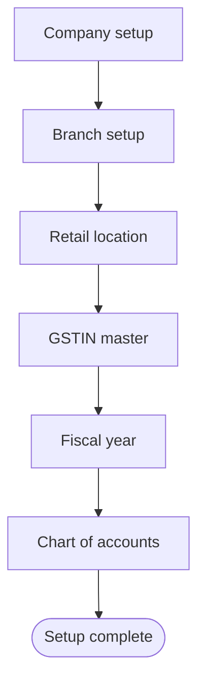

### Step 1: Company Setup

Navigate to **Settings > ERP Setup Wizard** or it auto-launches on first login.

| Field | Description | Example |
|-------|-------------|---------|
| Company Name | Legal name as per PAN | "Jewel India Pvt Ltd" |
| PAN | Permanent Account Number | "AABCJ1234K" |
| TAN | Tax Deduction Account Number | "DELJ12345K" |
| CIN | Corporate Identity Number (if applicable) | "U74999DL2020PTC123456" |
| GSTIN | Primary GST number | "07AABCJ1234K1Z5" |
| Address | Registered office address | Full address |
| Cash Receipt Limit | Sec 269ST limit (default: 1,99,999) | 199999 |
| Cash Payment Limit | Sec 40A(3) limit (default: 10,000) | 10000 |

### Step 2: Branch Setup

Branches represent state-level groupings.

| Field | Description | Example |
|-------|-------------|---------|
| Branch Name | Descriptive name | "Delhi Branch" |
| State | Indian state | "Delhi" |
| Company | Parent company | "Jewel India Pvt Ltd" |

### Step 3: Retail Location Setup

Retail locations are individual stores or showrooms. All transactions are isolated per retail.

| Field | Description | Example |
|-------|-------------|---------|
| Retail Name | Store name | "Jewel India - Karol Bagh" |
| Retail Code | Unique code (used in X-RETAIL-ID) | "R001" |
| Branch | Parent branch | "Delhi Branch" |
| Bill Series Prefix | Prefix for bill numbering | "R001" |
| Email | Store email | "karolbagh@jewelindia.com" |
| Cash Ledger | Default cash account | Auto-created |

### Step 4: GSTIN Master

When you save a GSTIN, the system automatically creates **6 GST ledger accounts**:
- Input CGST, Input SGST, Input IGST
- Output CGST, Output SGST, Output IGST

Plus **6 RCM (Reverse Charge) ledger accounts** if applicable.

### Step 5: Fiscal Year

| Field | Description | Example |
|-------|-------------|---------|
| FY Code | Short identifier | "26-27" |
| Start Date | Always April 1 in India | "2026-04-01" |
| End Date | Always March 31 | "2027-03-31" |
| Retail | Which location this FY belongs to | "R001" |

> **Important:** Activate the fiscal year on the retail master after creating it.

### Step 6: User Management

Create user accounts for your staff:

1. Go to **Settings > User Management**
2. Click **Add User**
3. Assign a role (Admin, Manager, Operator, etc.)
4. Assign retail location access (users can access multiple locations)

---

## 5. Master Data Setup

Master data must be configured before creating transactions. Navigate to the **Setup** menu.

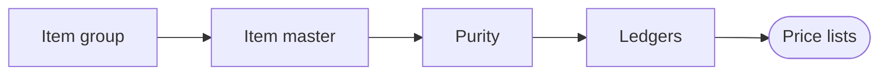

### 5.1 Chart of Accounts

The chart of accounts is pre-seeded with standard Indian accounting groups:

| Code | Group Name |
|------|-----------|
| **A** | Assets |
| **FA** | Fixed Assets |
| **CA** | Current Assets |
| **L** | Liabilities |
| **CL** | Current Liabilities |
| **I** | Income |
| **E** | Expenses |
| **DI** | Direct Income |
| **II** | Indirect Income |
| **DE** | Direct Expenses |
| **IE** | Indirect Expenses |

Navigate to **Setup > Chart of Accounts** to view or add custom account groups.

### 5.2 HSN (Harmonized System Nomenclature)

HSN codes are mandatory for GST compliance.

| Field | Description | Example |
|-------|-------------|---------|
| HSN Code | Standard HSN/SAC code | "7113" |
| Description | Item description | "Gold Jewellery" |
| CGST % | Central GST rate | 1.50 |
| SGST % | State GST rate | 1.50 |
| IGST % | Interstate GST rate | 3.00 |

Common jewellery HSN codes:
- **7113** - Articles of jewellery (Gold, Silver, Platinum)
- **7108** - Gold (unwrought, semi-manufactured)
- **7102** - Diamonds (unworked or simply sawn)
- **7103** - Precious stones
- **7117** - Imitation jewellery

### 5.3 Item Groups

Before creating items, set up item groups to organise your catalogue. Item groups act as categories that items are filed under.

1. Navigate to **Setup > Item Groups**
2. Click **Add Item Group**
3. Enter:
   - **Group Name**: e.g., "Gold Jewellery", "Diamond Jewellery", "Silver Articles", "Coins & Bars"
4. Save the group

Common jewellery item groups:
- Gold Jewellery
- Diamond Jewellery
- Silver Articles
- Precious Stones (Loose)
- Coins & Bars
- Imitation Jewellery

### 5.4 Items

| Field | Description | Example |
|-------|-------------|---------|
| Short Code | Unique identifier | "GOLD22K" |
| Item Name | Display name | "Gold 22K" |
| Item Type | Metal / Raw / Stone / Coin / Other | "Metal" |
| UOM | Unit of Measure (Gm/Pcs/Ct) | "Gm" |
| HSN | Linked HSN code | "7113" |
| Purchase Ledger | Default ledger for purchases | "Purchase - Gold" |
| Sale Ledger | Default ledger for sales | "Sales - Gold" |

### 5.5 Purity Master

Define gold/silver purity levels:

| Purity Name | Karat | Fine % |
|-------------|-------|--------|
| 24K | 24 | 99.9% |
| 22K | 22 | 91.6% |
| 18K | 18 | 75.0% |
| 14K | 14 | 58.5% |

### 5.5 Daily Gold Rate Update

The gold rate must be updated every business day before creating any sales or purchase bills. The system uses the current rate to auto-calculate gold values on invoices.

1. Navigate to **Setup > Gold Rates**
2. Click **Update Rate**
3. For each purity (24K, 22K, 18K, etc.), enter:
   - **Buying Rate**: Price at which the store buys gold (per gram) — used for old gold purchases and karigar valuation
   - **Selling Rate**: Price at which the store sells gold (per gram) — used for sales invoices
4. Click **Save**

> **Important:** Rates apply from the moment they are saved. Any bill created before updating will use the previous day's rate. Always update rates at the start of the business day.

The system stores a full rate history. To view historical rates, navigate to **Setup > Gold Rates > Rate History** and filter by date range.

### 5.6 Packets (Stone/Diamond)

Packets define stone specifications for pricing:

| Field | Description | Example |
|-------|-------------|---------|
| Packet Group | Category | "Natural Diamonds" |
| Stone Item | Linked item | "Diamond - Natural" |
| Shape | Cut shape | "Round Brilliant" |
| Color | Stone color | "D" |
| Clarity | Clarity grade | "VVS1" |
| Sieve | Sieve size | "0.90-1.00" |
| Retail Rate | Per-carat rate for retail | 85000 |
| Wholesale Rate | Per-carat rate for wholesale | 72000 |
| Solitaire | Is this a solitaire? | Yes/No |

### 5.7 TDS & TCS Sections

Configure Tax Deducted/Collected at Source sections:

**Common TDS Sections:**
- **194A** - Interest (10%)
- **194C** - Contractor payment (1-2%)
- **194H** - Commission/brokerage (5%)
- **194Q** - Purchase of goods (0.1%)

**Common TCS Sections:**
- **206C(1H)** - Sale of goods above threshold (0.1%)

#### Applying TDS on a Purchase Voucher

TDS is deducted at source when you pay a vendor. Apply it directly inside the Purchase Voucher:

1. Open (or create) a **Purchase Voucher** (**Purchases > Purchase Voucher**)
2. Select the vendor ledger — a **TDS** panel appears below the item table if TDS-applicable vendors are flagged in their ledger
3. In the TDS panel:
   - **Section**: Select the applicable section (e.g., 194Q for goods purchase)
   - **Rate %**: Auto-filled from the section master; override if needed
   - **TDS Amount**: Calculated automatically on the taxable base (usually net purchase value before GST)
4. The TDS amount is shown in the **Deduction** row in the payment summary
5. On save, the system posts:
   - **Dr** Vendor A/c (full invoice value)
   - **Cr** Purchase A/c (net value)
   - **Cr** TDS Payable A/c (the deducted amount)
6. The net amount payable to the vendor = Invoice Amount − TDS Deducted

**Paying the TDS to the Government:**
After deducting TDS, remit the collected amount via a **Payment Voucher**:
- **Dr** TDS Payable A/c
- **Cr** Bank A/c

View all deductions in **Reports > TDS Register** (Section 12.4).

#### Applying TCS on a Sales Voucher

TCS is collected from the buyer and remitted to the government. For jewellery sales above ₹50 lakhs aggregate per year per buyer (Section 206C(1H)):

1. In the **Sales Voucher**, the TCS row appears automatically once the buyer's aggregate exceeds the threshold
2. The system calculates TCS at 0.1% on the sale amount above the threshold
3. TCS is added to the buyer's invoice total and posted to **TCS Collected A/c** (liability)
4. Remit via Payment Voucher: **Dr** TCS Collected A/c → **Cr** Bank

View all collections in **Reports > TCS Register** (Section 12.5).

### 5.8 Sales Person Master

| Field | Description | Example |
|-------|-------------|---------|
| Name | Salesperson name | "Rahul Sharma" |
| Ledger | Linked commission ledger | "Commission - Rahul" |
| Commission Rate | Percentage | 2.5 |
| Commission On | Base for calculation | "Net Amount" |
| Deduct Discount | Deduct customer discount? | Yes |
| Apply on B2B | Apply to wholesale? | No |

---

## 6. CRM & Ledger Management

This module turns prospects into transacting parties: capture a lead, convert to a customer, create the backing ledger, and complete KYC.

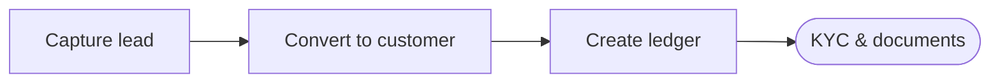

### 6.1 Understanding Ledgers

In Jewel India ERP, every entity (customer, vendor, bank, expense account) is a **Ledger**. Ledgers can have multiple roles:

| Role | Code | Description |
|------|------|-------------|
| Customer | CO | Retail/wholesale buyers |
| Vendor | VD | Suppliers of finished goods |
| Dealer | DL | B2B wholesale partners |
| Karigar | KR | Artisans / manufacturers |
| Bank | BA | Bank accounts |
| Cash | CA | Cash accounts |
| Sundry Creditors | SC | Amounts payable |
| Sundry Debtors | SD | Amounts receivable |
| Refinery | REF | Refinery houses |
| Melting House | MLT | Melting service providers |
| Hallmark | HM | Hallmarking centres |
| Income | INC | Income accounts |
| Expense | EXP | Expense accounts |

### 6.2 Creating a Ledger

1. Navigate to **CRM > Ledger**
2. Click **New Ledger**
3. Fill in the required fields:
   - **Account Name**: Display name (e.g., "Ravi Jewellers")
   - **Account Group** *(required)*: Classification from the Chart of Accounts (e.g., Sundry Debtors). **Every ledger must belong to an account group** — the form will block submission and the API will reject any create/update attempt without one. Selecting a role auto-suggests a sensible group; you can still override it.
   - **Roles**: Assign one or more roles (Customer, Vendor, etc.)
   - **GSTIN**: Customer's/vendor's GST number (for GST invoicing)
   - **State**: State of the party (for IGST vs CGST/SGST determination)
   - **Contact details**: Mobile, email, address

> **Note — Quick Add from Customer Order:** If you click "+ New Ledger" while filling a Customer Order (or similar voucher), the system returns you to the originating page after saving and automatically pre-fills the newly created ledger.
4. **Documents**: Upload PAN card, Aadhar, GST certificate, etc.

### 6.3 Ledger List

Navigate to **CRM > Ledger** to see all ledger accounts. The list includes the following features:

| Column / Feature | Description |
|------------------|-------------|
| **Name** | Ledger account name |
| **Roles** | Role badges (CO, VD, KR, DL, etc.) assigned to the ledger |
| **Group** | Account group with parent group shown above |
| **Address** | Registered address |
| **Sort** | Sort by Name, Address, Group (Asc), or Group (Desc) using the dropdown |

**Actions per row:**

- **Edit** (pencil icon): Open the ledger for editing
- **Documents** (paperclip icon): Manage attached documents (PAN, Aadhar, GST certificate, etc.) — available for Customer, Vendor, Karigar, and Dealer ledgers only
- **Delete** (trash icon): Delete the ledger — disabled for system ledgers (Cash, GST accounts, etc.) which show a tooltip "System ledger — cannot be deleted"

> **Note:** Deleting a ledger is permanent. Ledgers with existing transactions cannot be deleted — close or deactivate them instead.

### 6.4 Bulk Ledger Import (CSV)

For large migrations or bulk creation of ledger accounts, use the CSV import feature instead of creating entries one by one.

1. Navigate to **CRM > Ledger > Import**
2. Click **Download Template** to get the CSV format
3. Fill in the template with your ledger data:
   - Account Name, Account Group, Role(s), GSTIN, State, Mobile, Email, Opening Balance (Dr/Cr)
4. Upload the completed CSV file
5. The system validates each row and shows errors if any fields are missing or invalid. **Rows without a resolvable `ac_group_name` are skipped** — every imported ledger must map to an existing account group in the Chart of Accounts.
6. Confirm the import — successfully validated rows are created as ledger accounts

> **Tip — Bank / POS charge ledgers:** The system now auto-seeds common bank & POS-related expense ledgers (Cash Pickup Charges, Cash Deposit Charges, Settlement Charges, Low Usage Charges, POS Machine Installation/Rental/Service Charges) under **Bank Charges and Commission**. If existing ledgers in your database have no account group, run `python manage.py seed_system_ledgers` once — the command will backfill the correct group on any matching orphan ledger.

> **Tip:** Use bulk import during migration from another ERP. See Section 22 for the full migration workflow.

### 6.5 Customer History

Navigate to **CRM > Customer History** to view:
- All past purchases by a customer
- Payment history and outstanding dues
- Gold scheme enrollments
- Customer order history

---

## 7. Sales Module

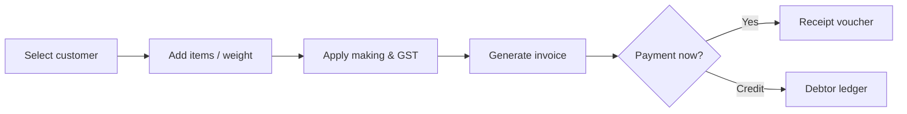

### 7.1 Sales Workflow

```
Estimate (optional)
    |
    v
Customer Order (with advance receipt)
    |
    v
Sales Approval (optional, for high-value sales)
    |
    v
Sales Voucher (Invoice / Bill)
    |
    v
Sales Return (if needed)
```

### 7.2 Creating an Estimate

An estimate is a quotation given to a customer before any order is confirmed. It does not create accounting or inventory entries — it is purely for reference.

**Step-by-step:**

1. Navigate to **Sales > Estimate**
2. Click **New Estimate**
3. Fill in the header:
   - **Customer**: Select or type the customer ledger name. For walk-in customers, select the generic "Cash Customer" ledger.
   - **Date**: Defaults to today; change if needed.
   - **Salesperson**: Assign the responsible salesperson.
   - **Remarks**: Optional note printed on the estimate.
4. Add items to the estimate:
   - Click **Add Item** (or scan a barcode if estimating against existing stock)
   - **Item**: Select the item type (e.g., Gold 22K Ring)
   - **Pcs**: Number of pieces
   - **Gross Weight (GW)**: Total weight of the piece in grams
   - **Net Weight (NW)**: Weight after deducting stone weight
   - **Purity**: Select purity (22K, 18K, etc.) — the system fetches today's gold rate automatically
   - **Making Type**: Select how making charges are calculated (Fixed / Per Gram / Percentage)
   - **Making Value**: Enter the making charge amount
   - **Stone Details**: If the piece contains stones, add packets with pieces and carats
   - The **Amount** column auto-calculates: `Net Weight × Rate × (Purity%) + Making + Stone Value`
5. The **Summary** section auto-computes:
   - Gold Value, Making Charges, Stone Value, Other Charges
   - CGST + SGST (or IGST for inter-state)
   - **Total Amount**
6. Click **Save** to record the estimate, or **Print** to hand a printed quote to the customer
7. **Convert to Order**: On the saved estimate, click **Convert to Customer Order** to carry all line items into a Customer Order (Section 7.3) without re-entering them

> Estimates do not reserve stock or block inventory. They are informational only.

### 7.3 Customer Orders

Customer orders represent advance bookings, often with a fixed gold rate option.

1. Navigate to **Sales > Customer Order**
2. Click **New Order**
3. Select customer, add items with specifications:
   - Pieces, gross weight, purity
   - Item name (captured and stored per line for clearer prints)
   - Making charges, other charges
4. **Fixed Gold Rate** *(checkbox)*: Lock the gold rate at the time of ordering. When enabled, the form fetches and freezes the current 14K / 18K / 22K rates.
5. **Salespersons**: Salesperson 1 is mandatory; Salesperson 2 is optional (use "None" to leave unassigned).
6. **Advance Receipt**: Record advance payment (creates an RCPT voucher automatically)
7. **Print**: The customer-order printout is an A4 B&W format with shop letterhead, item table, totals, gold-rate band, and signature blocks.

### 7.4 Sales Invoice (Sales Voucher)

1. Navigate to **Sales > Sales Voucher**
2. Click **New Sale**
3. **Scan barcodes** or manually add items
4. System auto-computes:
   - Gold value (weight x rate x purity)
   - Making charges
   - Stone value
   - GST (CGST+SGST for intra-state, IGST for inter-state)
   - Round-off
5. **Payment Methods**:
   - Cash (limited to Sec 269ST ceiling per FY per customer)
   - Bank transfer / UPI / Card
   - Old Gold adjustment (auto-creates purchase voucher)
   - Advance deduction (from customer order)
6. **Save & Print** the invoice

### 7.5 GST Bill Number (Auto-Generation)

When enabled, the system automatically assigns a separate GST bill number to each sales voucher. This number follows the format `GST/<retail code>/<FY>/NNNNN` (e.g., `GST/R001/26-27/00001`) and auto-increments per retail location per fiscal year.

**Enabling GST Bill Numbers:**

1. Navigate to **Settings > Bill Calculation**
2. Toggle **GST Bill Number** to ON
3. The setting takes effect immediately for all new sales vouchers

**How it works on the Sales Voucher:**

- When the setting is enabled, a **GST Bill No** field appears in the sales voucher header
- The field is auto-populated with the next available number (read-only)
- The number is finalised when the voucher is saved
- The GST bill number is used as the invoice number in GSTR-1 and e-invoice exports
- If the setting is disabled, the regular voucher number is used for GST reporting instead

> **Note:** Enabling this mid-year is safe — the sequence starts from `00001` for the current fiscal year and does not retroactively number existing vouchers.

### 7.6 Sales Return

1. Navigate to **Sales > Sales Return**
2. Select the original sales voucher — its items are pulled into a **15-column return table** that mirrors the sales voucher layout (Barcode, Packet, Item, Pcs, Ct, GW, Making / Making Type / Making Value, Purity, Tunch, Fine Wt, Rate, Amount).
3. Choose items being returned:
   - Sub-item rows are indented with a ↳ marker. Delete icons appear only on manual (non-barcode) sub-items.
   - **Tunch** and **Fine Wt** are shown only for gold sub-items (item type = Raw). Non-gold rows leave them blank.
   - Sub-item Amount auto-calculates: `GW × Tunch/100 × Rate` for gold, `Ct × Rate` for stones, `GW × Rate` otherwise.
4. **Discount auto-detection**:
   - **Full return** (all items from the ref bill) — the original bill's full discount is re-applied automatically.
   - **Partial return** — discount defaults to 0, and an amber note displays the original bill's discount for reference.
5. The return is linked back to the original sale via `sales_voucher_ref` and `original_sale_gst_billno`, preserved on save.
6. System auto-reverses:
   - Inventory (barcodes return to stock)
   - Accounting entry (credit note)
   - Salesperson commission (reversal created)
7. **Credit Note print**: Click **Print** in the Sales Return list to produce a printable credit note (A4, matches the sales invoice style) showing returned items, original invoice reference, discount, CGST/SGST/IGST breakdown, total credit, and amount in words. No separate CNDN entry is required.

### 7.7 Cheque Deposit Tracking

When customers pay by cheque, you can track the cheque through its lifecycle (received → deposited → cleared/bounced).

1. After recording a **Receipt Voucher** with a bank account, navigate to **Sales > Cheque Deposits**
2. The list shows all cheques received but not yet deposited
3. Click **Mark as Deposited** when the cheque is submitted to the bank:
   - Enter the deposit date and bank name
4. Once the bank confirms clearance, click **Mark as Cleared**
5. If a cheque bounces, click **Mark as Bounced**:
   - The system creates a reversal journal entry automatically
   - The customer's outstanding balance is restored

This ensures your bank book reflects only cleared funds, not just received cheques.

### 7.8 E-Way Bills

For inter-state sales above the threshold, e-way bills are required.

1. Navigate to **Sales > E-Way Bills**
2. Select the sales voucher
3. Fill in transport details
4. Generate or cancel e-way bills

---

## 8. Purchase Module

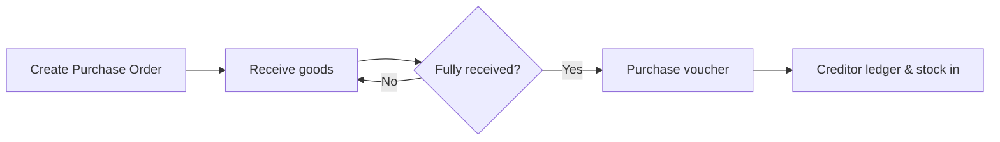

### 8.1 Purchase Workflow

```
Purchase Order (to Karigar / Vendor)
    |
    v
Purchase Voucher (Invoice from vendor)
    |
    v
Purchase Return (if defective)
```

### 8.2 Purchase Order

A Purchase Order (PO) is sent to a karigar or vendor to initiate manufacturing or procurement. It does not create accounting or inventory entries — those happen when the goods are received via a Purchase Voucher.

**Step-by-step:**

1. Navigate to **Purchases > Purchase Order**
2. Click **New Purchase Order**
3. Fill the header:
   - **Order Type**: Choose the purpose:
     - **Customer Order** — ordered against a specific customer booking
     - **Stock** — general replenishment for showroom stock
     - **Repair** — repair job for a customer's item
   - **Karigar / Vendor**: Select the artisan or vendor who will make/supply the items
   - **Expected Delivery Date**: Target date for receiving the items
   - **Salesperson**: Assign if applicable
   - **Remarks / Instructions**: Any special instructions for the karigar (finish, design, stone setting notes)
4. Add items:
   - **Item**: Item type (Gold 22K, Diamond Ring, etc.)
   - **Pieces**: Number of pieces
   - **Gross Weight**: Expected gross weight in grams
   - **Purity**: Metal purity
   - **Making Charges**: Agreed making rate per gram or fixed amount
   - **Design Code**: Link to a saved design (optional; see Section 10.5)
   - **Notes per row**: Any item-specific instruction
5. **Pending Customer-Order Picker**: When the order type is **Customer Order**, click **Pick from Pending Orders** to open a modal listing all customer-order line items not yet assigned to a PO. Multi-select the items — they auto-fill into the PO with a CO reference badge on each row. If a row is deleted from the PO, that item returns to the pending pool.
6. Click **Save** to record the order
7. Click **Send** to mark the order as dispatched to the karigar:
   - The PO status changes from *Draft* to *Sent*
   - A printable order slip (A4) is generated with shop letterhead, item specifications, making rates, and the expected delivery date — hand this to the karigar or share via WhatsApp
   - Once sent, item-level edits are locked (you can still edit remarks and expected delivery date)
8. When goods arrive, use **Manufacturing > Receive > Job Work Receive** (Section 9.3) and reference this PO to close it out

### 8.3 Purchase Voucher (Invoice)

A Purchase Voucher records the receipt of goods (finished jewellery, raw materials, or diamonds) from a vendor or karigar, and creates the corresponding accounting entry and inventory movement.

**Step-by-step:**

1. Navigate to **Purchases > Purchase Voucher**
2. Click **New Purchase**
3. Fill the header:
   - **Date**: Date of receipt (defaults to today)
   - **Vendor Bill No**: The vendor's/karigar's invoice number (for your records and TDS matching)
   - **Vendor**: Select the vendor or karigar ledger
   - **Bill Type**: Select the purchase category:
     - **SC** (Stock from Vendor) — finished goods bought from a supplier
     - **CO** (Karigar Manufacturing) — items received from a karigar after manufacturing
     - **RM** (Raw Material) — gold/silver bars, loose stones
4. Add items received:
   - **Scan Barcode**: If the vendor attaches barcodes, scan to auto-fill item details
   - **Manual Entry**: Click **Add Row** and fill:
     - **Item**: Select item type (Gold 22K, Diamond Ring, etc.)
     - **Pieces**: Number of pieces
     - **Gross Weight**: Total weight received (grams)
     - **Net Weight**: Weight after stone deduction
     - **Purity**: Metal purity (e.g., 22K = 91.6%)
     - **Rate**: Gold rate per gram (auto-filled from today's rate, editable)
     - **Making Charges**: Labour/making charges billed by vendor
     - **Stone Details**: For pieces with diamonds/stones — select packets, enter carats
   - The **Amount** column auto-calculates: `NW × (Purity%) × Rate + Making + Stone Value`
5. **GST**: For purchases from registered vendors, enter the GST charged on their invoice:
   - CGST + SGST (intra-state) or IGST (inter-state)
   - This creates input tax credit (ITC) that offsets your GST liability
6. **TDS** (if applicable):
   - If the vendor is TDS-applicable (Section 194Q for goods, 194C for karigars), select the TDS section
   - The TDS amount is deducted from the net payable and posted to **TDS Payable A/c**
   - See Section 5.7 for how to configure TDS sections
7. **RCM (Reverse Charge Mechanism)**: Applies automatically for purchases from unregistered dealers or specific service categories. When RCM is active, you pay GST directly to the government instead of to the vendor — a liability entry is created automatically.
8. **Payment**: Record payment made at the time of purchase (if cash/immediate):
   - Select the payment ledger (Cash or Bank)
   - The voucher can also be saved as **Credit** (payable to vendor) for later payment via a Payment Voucher
9. Click **Save** — the system auto-creates:
   - **Accounting entry**: Dr Purchase A/c → Cr Vendor A/c (or Cr Cash/Bank if paid immediately)
   - **Inventory entry**: Barcodes are generated and items enter stock
   - **Raw material ledger**: If RM items, the weight is added to the raw material balance

> **Tip**: After saving, click the **Print** icon to get a goods receipt note (GRN) that you can file alongside the vendor's invoice.

### 8.4 Purchase Return

1. Navigate to **Purchases > Purchase Return**
2. Select original purchase voucher
3. Choose items being returned
4. System reverses inventory and accounting entries

### 8.5 Customer Purchase (Old Gold)

When a customer brings old gold (jewellery, coins, bars) to exchange or sell, record it as a Customer Purchase. This creates a purchase entry in your books and reduces the customer's payable amount on the linked sales invoice.

**Step-by-step:**

1. Navigate to **Purchases > Customer Purchase**
2. Click **New Customer Purchase**
3. Fill the header:
   - **Date**: Date of the transaction
   - **Customer**: Select the customer's ledger account
   - **Linked Sale Voucher** *(optional)*: If the old gold is being exchanged against a sale, select the sales voucher number. The old gold value will be auto-deducted from that bill's outstanding amount.
4. Add the old gold item(s):
   - **Description**: Brief description (e.g., "22K Gold Bangles — 2 pieces")
   - **Gross Weight**: Weigh the item on the scale and enter the gross weight in grams
   - **Stone Weight**: If the item has stones/enamel, enter stone weight to deduct
   - **Net Gold Weight**: Auto-calculated = Gross Weight − Stone Weight
   - **Purity (Tunch %)**: Enter the tested purity percentage (e.g., 91.6 for 22K). If the purity is unknown, test it first.
   - **Fine Gold Weight**: Auto-calculated = Net Weight × Purity% / 100
   - **Rate**: The buying rate per gram of fine gold (auto-filled from today's buying rate set in Gold Rates; editable if you negotiate a different rate)
   - **Amount**: Auto-calculated = Fine Gold Weight × Rate
5. Repeat for each old gold item brought by the customer
6. The **Total Old Gold Value** is shown at the bottom
7. **Adjustment against sale**:
   - If linked to a sales voucher, the system deducts the old gold value from the sale total
   - The revised **Net Payable** by the customer = Sale Amount − Old Gold Value
   - If old gold value exceeds the sale amount, the difference is paid back to the customer in cash
8. Click **Save** — the system creates:
   - **Accounting entry**: Dr Old Gold Purchase A/c → Cr Customer A/c (reduces what the customer owes)
   - **Inventory entry**: The old gold is added as raw material stock (to be melted/refined)

> **Making deduction**: Some stores deduct a melting/refining charge (typically 2–5%) before arriving at the buying rate. Apply this by reducing the rate or adding a deduction row before saving.

> **Purity testing**: For items of unknown purity, issue them to a karigar or refinery for purity testing before creating the Customer Purchase.

---

## 9. Manufacturing Module

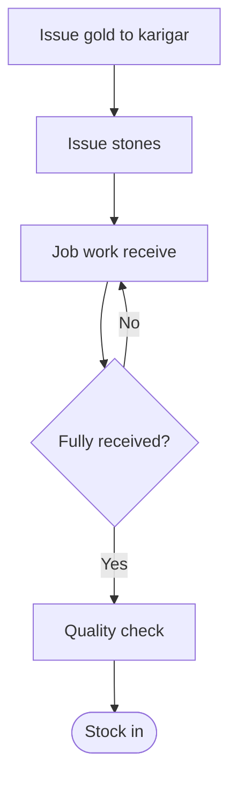

### 9.1 Manufacturing Workflow

The manufacturing module tracks the complete lifecycle of jewellery creation:

```
Gold Issue to Karigar
    |
    v
Stone Issue to Karigar
    |
    v
Karigar receives and manufactures
    |
    v
Job Work Receive (finished item)
    |
    v
Stone Return (unused stones)
    |
    v
Hallmark Issue → Hallmark Receive
    |
    v
Ready for Sale (barcode generated)
```

### 9.2 Issue Operations

#### Job Work Issue
Issue raw gold and components to a karigar for manufacturing.

1. Navigate to **Manufacturing > Issue > Job Work**
2. Select karigar (artisan)
3. Add items to issue:
   - Gold (item, weight, purity)
   - Customer order reference (if applicable)
   - Design/sketch attachment
4. Save to create the issue slip

#### Gold Issue
Dedicated gold issuance to karigars (separate from job work items).

1. Navigate to **Manufacturing > Issue > Gold Issue**
2. Select karigar, item, weight, purity
3. Save the issuance

#### Stone Issue
Issue diamonds/precious stones to karigars for setting.

1. Navigate to **Manufacturing > Issue > Stone Issue**
2. Select karigar and stone packets
3. Specify pieces, carats
4. Save the stone issue

#### Other Issues
- **Hallmark Issue**: Send items for BIS hallmarking
- **Refinery Issue**: Send scrap/old gold to refinery
- **Melting Issue**: Send items for melting

### 9.3 Receive Operations

#### Job Work Receive
Receive finished items from karigars.

1. Navigate to **Manufacturing > Receive > Job Work Receive**
2. Select karigar and the original issue slip
3. Enter received item details:
   - Gross weight, net weight
   - Stone details
   - Loss (gold loss during manufacturing)
   - Making charges
4. System auto-generates:
   - **Barcode** for the finished item
   - **Inventory entry** (item enters stock)
   - **Raw material deduction** (gold consumed)

#### Stone Return
Receive unused stones back from karigar.

#### Hallmark Receive
Record hallmarked items received back, including HUID numbers.

### 9.4 How the Refining Flows Work (Refinery & Melting)

The ERP models two parallel "send metal out, get refined metal back" processes. They share one structure, so once you understand one, you understand the other.

| Flow | What it is for | Ledger type |
|------|----------------|-------------|
| **Refinery** | Send impure or old gold to a refiner and receive purer gold back | Refinery (REF) |
| **Melting** | Melt scrap or old gold down and receive a homogenised bar back | Melting House (MLT) |

#### The repeating unit: Issue → Receive

Every flow is a two-step pair, and each step is a header (date, bill no, the house you dealt with) plus line items:

- **Issue** records what you *sent out* — item, gross weight, and (for stone/jewellery items) pieces, carats, and packet.
- **Receive** records what *came back*, adding the conversion result: converted purity, converted weight, loss weight, and loss %.

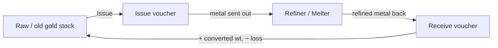

#### Loss is calculated for you

On the Receive forms, as you type the **Conv. wt** (the refined weight that came back), the system fills in:

- **Loss wt** = Gross wt − Conv. wt
- **Loss %** = Loss wt ÷ Gross wt × 100

Both stay editable if you need to override them, and a **totals row** plus a **summary strip** show the combined gross, converted, and overall loss % at a glance.

#### How stock moves

You do not adjust stock by hand — it follows the vouchers automatically:

- Saving an **Issue** *decrements* raw-metal stock (the metal left your premises).
- Saving a **Receive** *increments* stock with the converted weight that came back.

These movements appear in **Inventory > Reports > Raw Material Ledger** and **Raw Material Balance** (Section 10.7), and are summarised in the **Refinery Report** (Section 16.7).

#### A note on old gold (raw metal)

Old gold is *raw metal* — it has no pieces, no stone carat, and no packet, only weight. On these forms it is normal to leave **Pcs**, **Ct**, and **Packet** blank; those fields are only required for stone or jewellery items. The gross and converted weights are what matter.

#### Where to find them

| Flow | Issue | Receive |
|------|-------|---------|
| Refinery | Manufacturing > Issue > Refinery Issue | Manufacturing > Receive > Refinery Receive |
| Melting | Manufacturing > Issue > Melting Issue | Manufacturing > Receive > Melting Receive |

### 9.5 Repair Jobs

Repair jobs track customer-owned items (rings, bangles, etc.) taken in for repair, alteration, or polishing. Each job card records the item in, the work done, and the item out — maintaining a clear audit trail of customer property.

#### Creating a Repair Job Card

1. Navigate to **Manufacturing > Repair > Repair Job Cards**
2. Click **New Repair Job**
3. Fill the header:
   - **Customer**: Select the customer's ledger account
   - **Date Received**: Date the item was taken in for repair
   - **Promised Date**: Expected completion / return date
   - **Salesperson**: Staff member who accepted the item
4. Add the item(s) to be repaired:
   - **Item Description**: What the piece is (e.g., "22K Gold Ring")
   - **Gross Weight**: Weigh the item and record it. This creates an accountability trail — you know exactly how much gold the customer handed over.
   - **Purity**: If known, enter purity
   - **Work Required**: Description of the repair (e.g., "Rhodium plating, resize to size 16, re-set loose stone")
   - **Estimated Charges**: Labour/repair charges quoted to the customer
5. Click **Save** — a **Job Card Number** is generated
6. **Print the Job Card**: Click **Print** to hand the customer a receipt with the job card number, description of work, weight received, and promised return date. The customer uses this as a claim slip.

#### Issuing the Item for Repair

Once accepted:

1. Open the repair job card
2. Click **Issue to Karigar** (if outsourcing) or **Issue to Counter** (if in-house)
3. Select the karigar/bench and record any additional gold or stones issued for the repair

#### Completing and Returning the Repair

When the repaired item is ready:

1. Open the repair job card
2. Click **Receive from Karigar** (if outsourced) — enter the returned weight and any gold used/remaining
3. Record final **Repair Charges** (may differ from estimate)
4. Click **Mark as Completed**
5. When the customer collects the item:
   - Click **Deliver to Customer**
   - Collect the repair charges — the system creates a **Receipt Voucher** for the payment
   - Status changes to **Delivered**

#### Repair Charges Billing

Repair charges are billed separately:
- If the customer pays cash: a **Receipt Voucher** is auto-created crediting Repair Income A/c
- If charges are added to a linked Sales Voucher: the repair amount is included as an "Other Charges" line on the bill

> **Weight accountability**: If the returned weight is less than the received weight, the difference must be explained (gold used in repair, stone added, etc.). The system flags weight discrepancies for review before allowing delivery.

---

## 10. Inventory & Barcode Management

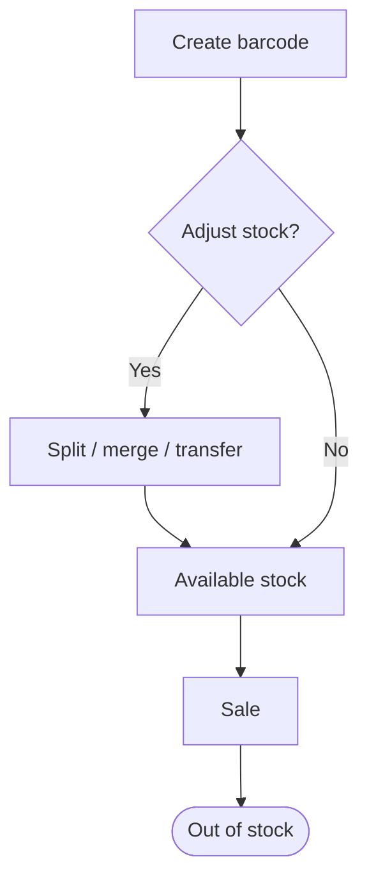

### 10.1 Barcode System

Every finished jewellery piece in Jewel India ERP has a unique **13-digit barcode** with an auto-generated QR code. Barcodes are the primary unit of inventory tracking.

**Barcode contains:**
- Item type (Gold, Diamond, Silver, etc.)
- Gross weight, net weight
- Purity (22K, 18K, etc.)
- Making value, other charges
- Stone details (packets, carats)
- Total value
- Karigar code, design code
- Stock status

#### How Barcodes Are Created

Barcodes are generated automatically — you never need to create them manually. They are created at these points:

| Trigger | Where |
|---------|-------|
| Job Work Receive | Manufacturing > Receive > Job Work Receive |
| Purchase Voucher (finished goods) | Purchases > Purchase Voucher |
| Stock Journal (add stock) | Inventory > Stock Journal |
| Barcode Split / Merge | Inventory > Barcode Management |

#### Creating a Barcode via Stock Journal (manual)

If you need to add a barcode for a piece that did not come through manufacturing or purchase:

1. Navigate to **Inventory > Stock Journal**
2. Select **Receive** (adding to stock)
3. Click **Add Row** and fill:
   - **Item**: Item type (e.g., Gold 22K)
   - **Gross Weight**: Total weight in grams
   - **Net Weight**: Weight after stone deduction
   - **Purity**: Select purity (e.g., 22K)
   - **Making Type / Making Value**: How making charges are calculated
   - **Stone Details**: Add stone packets if the piece has diamonds or stones
   - **Karigar Code**: Who made the piece (optional)
   - **Design Code**: Linked design (optional)
   - **Rate**: Gold rate per gram (auto-filled from today's rate)
4. The **Total Value** auto-calculates
5. Add a **Remark** explaining why the barcode is being created (e.g., "Opening stock entry")
6. Click **Save** — a new barcode is generated and the piece enters stock

#### Printing Barcodes

To print a barcode label:
1. Navigate to **Inventory > Barcode Management > List**
2. Search for the barcode by number or item description
3. Click the **Print** icon on the row
4. A printable label appears with the barcode, QR code, item description, weight, purity, and value
5. Use a thermal label printer (58mm or 80mm roll) for physical tags, or print on A4 sheets for bulk labelling

### 10.2 Barcode Operations

#### Viewing Inventory
Navigate to **Inventory > Barcode Management > List** to see all barcodes in stock.

#### Barcode Split
Split one barcode into two (e.g., detaching a pendant from a set):

1. Navigate to **Inventory > Barcode Management > Split**
2. Select the barcode to split
3. The new barcode will be `<original>A`
4. Adjust weights and values for each piece

#### Barcode Merge
Combine two barcodes into one (e.g., assembling a set):

1. Navigate to **Inventory > Barcode Management > Merge**
2. Select barcodes to merge
3. A new barcode is generated with combined details

#### Barcode History
View the complete transaction trail of any barcode:

1. Navigate to **Inventory > Barcode History**
2. Search by barcode number
3. See all movements: creation, sale, return, transfer, etc.

### 10.3 Stock Transfer (Inter-Location)

Transfer inventory between retail locations:

1. Navigate to **Inventory > Stock Transfer**
2. Click **New Transfer**
3. Select destination retail location
4. Add barcodes to transfer
5. **Send**: Dispatches items (barcodes enter "in transit" state)
6. **Receive** (at destination): Accepts items into destination stock

### 10.4 Stock Journal

Manual stock adjustments for discrepancies:

1. Navigate to **Inventory > Stock Journal**
2. Select **Issue** (reduce stock) or **Receive** (add stock)
3. Add items with quantities
4. Provide remarks (reason for adjustment)

### 10.5 Design Management

The Design master stores the standard specifications for each jewellery design, so that when a Purchase Order is placed with a karigar, the expected weight, making charges, and stone composition are pre-filled automatically — reducing data entry errors.

**Creating a Design:**

1. Navigate to **Inventory > Design**
2. Click **New Design**
3. Fill the design details:
   - **Design Number**: Your internal design code (e.g., "RNG-001", "BNG-22K-SET")
   - **Design Name**: Descriptive name (e.g., "22K Plain Gold Bangle Pair")
   - **Item Type**: Select the item (Gold 22K, Diamond Ring, etc.)
   - **Expected Gross Weight**: Standard weight for this design in grams
   - **Making Type**: Fixed / Per Gram / Percentage
   - **Making Value**: Standard making charge for this design
   - **Loss Rate %**: Expected gold loss during manufacturing (used to calculate the issue weight to the karigar)
   - **Purity**: Metal purity
4. **Stone Composition** (for diamond/stone pieces):
   - Click **Add Stone**
   - Select packet type, expected pieces, carats per piece
   - Repeat for each stone type in the design
5. **Attachments**: Upload the design sketch, CAD file, or photograph (JPEG, PNG, PDF). These are accessible to karigars when viewing the Purchase Order.
6. Click **Save**

**Using a Design in a Purchase Order:**

When creating a Purchase Order (Section 8.2), select the **Design Code** on each item row. The system auto-fills the expected weight, making charges, and stone details from the design master — you can still override per-order.

**Design Catalogue:**

The saved design list acts as a catalogue of your product range. Use the search/filter on the Design list page to find designs by code, item type, or weight range.

### 10.6 RFID Inventory Counting

The ERP supports RFID-based inventory counting. Each jewellery piece can be assigned an RFID tag (EPC), allowing fast bulk inventory audits without manual barcode scanning. There are two screens:

- **RFID Tag Assignment** — links an RFID tag (EPC) to a barcode item.
- **RFID Inventory Count** — scans a batch of tags and reconciles them against stock.

> **How to open these screens:** In the left sidebar, go to **Inventory > RFID**, which expands to **Tag Assignment** and **Inventory Count**. (You can also reach them directly at `/inventory/rfid/tag-assign` and `/inventory/rfid/count`; opening `/inventory/rfid` redirects to Tag Assignment.)

#### Assigning RFID Tags

1. Open the **RFID Tag Assignment** screen (`/inventory/rfid/tag-assign`).
2. Use the **search box** to find an item by barcode number or item name. Use the **All items / Tagged only / Untagged only** filter to narrow the list, then click **Refresh** if needed.
3. **Click the row** for the item you want to tag. An assignment panel opens with that barcode selected.
4. In the **RFID Tag (EPC)** field, type the tag number or scan it with a reader (e.g. `E28011700000020FA2B45678`). Press **Enter** or click **Assign Tag**.
5. The tag is now linked to that barcode and shown in green in the **RFID Tag** column.

> **To remove a tag:** select the row, clear the tag field, and the button changes to **Clear Tag** — click it to unlink. Each EPC can only be assigned to one barcode; assigning a duplicate tag is rejected with an error.

#### Running an RFID Inventory Count

1. Open the **RFID Inventory Count** screen (`/inventory/rfid/count`).
2. Enter the scanned tags using **either** method:
   - **USB HID reader (live):** click into the **"USB HID Reader"** field and scan tags one by one. Each scan adds the EPC to the list automatically (the reader types the tag followed by Enter).
   - **Bulk paste:** paste a list of tag IDs into the **Tag list** box — one per line or comma-separated (e.g. exported from your reader software). Duplicates are removed automatically; the screen shows a live count of unique tags ready.
3. (Optional) Add a **Session note** for the audit trail, e.g. "Counter check after closing".
4. Click **Run Count** to compare the scanned tags against current stock. The system returns three categories:
   - **Matched** — scanned tags found in stock records (also shows whether each is *In Stock* or *Sold/Out*).
   - **Missing** — items that have an RFID tag assigned but were **not** scanned (in records, physically absent).
   - **Unexpected** — scanned tags that are **not** linked to any stock item (possible misplaced or foreign items).
5. Review each category using the **Matched / Missing / Unexpected** tabs. The summary bar shows total scanned and per-category counts.
6. Investigate any **Missing** or **Unexpected** items physically.
7. (Optional) Click **Run & Save Session** to persist this count as an audit record. The system assigns it a session number (e.g. `RFID…`) and stores it with your note. There is no separate "close" step — a saved session is a permanent snapshot. Use **Run Count** alone if you only want a quick check without saving.

> RFID sessions do **not** automatically adjust stock. After investigating discrepancies, use **Inventory > Stock Journal** to make any corrections (see section 10.4).

### 10.7 Raw Material Inventory

Track raw materials (unfinished gold, loose stones):

1. View balances at **Inventory > Reports > Raw Material Balance**
2. View transaction ledger at **Inventory > Reports > Raw Material Ledger**
3. Balances update automatically from purchases, manufacturing, and sales

---

## 11. Financial Accounting

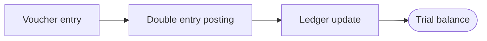

### 11.1 Double-Entry Bookkeeping

Jewel India ERP follows strict double-entry accounting:
- Every transaction has equal debits and credits
- The system validates balance before saving any voucher
- All amounts use precise decimal arithmetic (no floating-point rounding)

### 11.2 Voucher Types

| Type | Code | Usage |
|------|------|-------|
| Journal | JRNL | General adjustments, closing entries |
| Payment | PMNT | Payments to vendors/expenses |
| Receipt | RCPT | Receipts from customers |
| Receipt (Sale) | RCPT-SALE | Auto-generated from sales invoices |
| Contra | CONTRA | Cash ↔ Bank transfers |
| Sale | SALE | Auto-generated from sales vouchers |
| Purchase | PURC-SC/CO | Auto-generated from purchase vouchers |
| Sale Return | SALE-RET | Auto-generated from sales returns |
| Purchase Return | PURC-RET | Auto-generated from purchase returns |
| Credit Note | CN | Customer credit adjustments |
| Debit Note | DN | Vendor debit adjustments |
| Scheme | SCHM | Auto-generated from gold scheme payments |
| Salary | SLRY | Auto-generated from salary processing |
| Depreciation | DEPR | Auto-generated from fixed asset depreciation |

### 11.3 Creating Vouchers

#### New Voucher Entry

1. Navigate to **Financial Accounting > New Voucher Entry**
2. Select voucher type (Receipt / Payment / Journal / Contra)
3. You are taken to the voucher entry form with the type pre-selected

#### Payment Voucher (PMNT)

Records money paid to a vendor, supplier, or expense account.

**Step-by-step:**

1. Navigate to **Financial Accounting > New Voucher Entry > Payment**, or go to **Voucher Lists > Payment Vouchers** and click **Add New**
2. **Date**: Defaults to today; change if backdating within the active fiscal year
3. **Voucher No**: Auto-generated (read-only)
4. **Vendor Bill No**: Optionally enter the vendor's invoice/bill reference
5. **Add the vendor/expense line** (the party being paid):
   - In the **Account** field, type the vendor or expense ledger name (e.g., "Priya Gold Suppliers")
   - Enter the amount in the **Debit** column
   - Press **Tab** from the Credit field to add the row
6. **Allocate against outstanding purchase bills** (optional):
   - When you select a vendor ledger, the **Outstanding Purchase Bills** panel appears below the table
   - It lists all unpaid purchase invoices for that vendor with bill number, date, total, and outstanding amount
   - **Auto-fill (FIFO)**: Click to automatically allocate oldest bills first until the entered amount is exhausted
   - **Manual allocation**: Type specific amounts in the Allocate column for each bill
   - The footer shows: Party amount | Allocated | Unallocated (on account)
   - When you press Tab, the single vendor row is expanded into one row per allocated bill (with Ref Bill No filled), plus an "on account" row for any unallocated remainder
7. **Add the cash/bank line** (source of payment):
   - Select the Cash or Bank ledger in the **Account** field
   - Enter the same amount in the **Credit** column
   - Press **Tab** to add the row
8. Verify: **Total Debit = Total Credit** (difference must be 0)
9. Enter a **Narration** (e.g., "Payment to Priya Gold against PV-001")
10. Optionally attach supporting documents (up to 3 files)
11. Click **Save** (or press **F4**)

**Cash payment limit**: Payments over Rs 10,000 in cash to a single vendor per day are blocked under Section 40A(3). Use a bank account for larger payments.

#### Receipt Voucher (RCPT)

Records money received from a customer.

**Step-by-step:**

1. Navigate to **Financial Accounting > New Voucher Entry > Receipt**, or go to **Voucher Lists > Receipt Vouchers** and click **Add New**
2. **Date**: Defaults to today
3. **Add the cash/bank line** (where the money goes):
   - Select the Cash or Bank ledger in **Account**
   - Enter the amount in the **Debit** column
   - Press **Tab** to add the row
4. **Add the customer line** (the party paying):
   - Select the customer ledger in **Account** (e.g., "Rahul Mehta")
   - Enter the amount in the **Credit** column
5. **Allocate against outstanding sales bills** (optional):
   - The **Outstanding Sales Bills** panel appears for the selected customer
   - Use **Auto-fill (FIFO)** or manually allocate across bills
   - Press **Tab** from Credit to expand allocations into individual rows
6. Verify: **Total Debit = Total Credit**
7. Add narration, optional attachments, then **Save**

**Cash receipt limit**: Cash receipts over Rs 1,99,999 from a single customer per financial year are blocked under Section 269ST.

#### Journal Voucher (JRNL)

Used for adjustments, provisions, depreciation entries, and other non-cash transfers.

1. Navigate to **Financial Accounting > New Voucher Entry > Journal**
2. Add debit and credit lines with ledger accounts and amounts
3. The **Status** column is available for journal entries — set to "Against_Ref" to link to a specific invoice, or "onAccount" for general entries
4. In the **Ref Bill No** field, enter a sales or purchase invoice number to adjust its outstanding balance
5. Verify totals balance, add narration, and **Save**

#### Contra Voucher (CONTRA)

Transfers funds between Cash and Bank accounts (e.g., cash deposit or withdrawal).

1. Navigate to **Financial Accounting > New Voucher Entry > Contra**
2. Debit the receiving account (e.g., Bank for a deposit)
3. Credit the sending account (e.g., Cash)
4. Amounts must balance. Add narration and **Save**

#### Bill-wise Allocation (Details)

The bill allocation system ensures payments and receipts are properly matched to invoices:

- **Automatic matching**: Select a party ledger and the system fetches all unpaid invoices for that party
- **FIFO auto-fill**: One click allocates against the oldest outstanding bills first
- **Manual allocation**: Enter specific amounts per bill — useful for partial payments
- **On-account remainder**: Any unallocated amount is posted as an "on account" balance
- **Validation**:
  - Allocation cannot exceed the party amount in the voucher
  - Each bill allocation cannot exceed that bill's outstanding balance
  - Ledger must match — you cannot pay Vendor A's bill from Vendor B's ledger
- **Due amount tracking**: When a voucher is saved, the allocated amounts are deducted from each invoice's `due_amt`, keeping the outstanding report accurate

### 11.4 Voucher List Features

Navigate to any voucher list (e.g., **Financial Accounting > Voucher Lists > Payment Vouchers**) to see all vouchers of that type. Each voucher row includes:

| Action | Icon | Description |
|--------|------|-------------|
| **View/Edit** | Pencil | Open the voucher for viewing or editing |
| **Print** | Printer | Open a print-formatted view of the voucher for printing |
| **Attachments** | Paperclip | View or upload supporting documents (up to 3 files per voucher) |

**Keyboard shortcut:** Press **F2** from any voucher list to quickly navigate to the "Add New" form for that voucher type.

### 11.5 Opening Balances

Set up beginning balances for a new fiscal year:

1. Navigate to **Financial Accounting > Opening Balances**
2. Select ledger
3. Enter debit or credit opening balance
4. Save

> For subsequent years, use the **Sync Opening Balances** feature in Fiscal Year management.

### 11.6 Cash Gold Conversion

Cash Gold Conversion records the movement between your cash/bank accounts and your gold (raw material) stock when gold is bought or sold for cash outside of normal purchase/sales vouchers — typically when gold is purchased from a gold merchant for melting into raw material, or when refined gold is sold back to a refinery.

**Types:**

| Type | Code | Meaning |
|------|------|---------|
| Cash to Gold | CG | You spend cash to acquire gold (e.g., buying a gold bar) |
| Gold to Cash | GC | You receive cash in exchange for gold (e.g., selling scrap) |

**Step-by-step — CG (Cash to Gold):**

1. Navigate to **Financial Accounting > Cash Gold Conversion**
2. Click **New Entry**
3. Select type **CG**
4. Fill the fields:
   - **Date**: Transaction date
   - **Gold Ledger**: The raw material or gold account being credited/debited (e.g., "Raw Gold 22K")
   - **Cash/Bank Ledger**: The payment ledger (e.g., "Cash A/c" or "HDFC Bank")
   - **Weight**: Weight of gold in grams
   - **Purity**: Purity of the gold
   - **Fine Weight**: Auto-calculated = Weight × Purity%
   - **Rate**: Rate per gram of fine gold
   - **Amount**: Auto-calculated = Fine Weight × Rate
5. Add a **Narration** (e.g., "Purchase of 100g 22K gold bar from RK Gold")
6. Click **Save** — the system auto-creates a **Journal Voucher** with entries:
   - **Dr** Raw Gold A/c (the gold stock increases)
   - **Cr** Cash/Bank A/c (cash reduces)

**Step-by-step — GC (Gold to Cash):**

Same as above with **GC** type — the accounting entry reverses:
   - **Dr** Cash/Bank A/c
   - **Cr** Raw Gold A/c (gold stock reduces)

> Use this entry for gold merchant transactions that are not through the regular Purchase/Sale voucher flow. For old gold taken from customers as exchange in a sale, use **Purchases > Customer Purchase** (Section 8.5) instead.

### 11.7 Ledger Statement

View detailed transaction history for any ledger:

1. Navigate to **Financial Accounting > Ledger Statement**
2. Select ledger and date range
3. View all debits, credits, and running balance

### 11.8 Outstanding Report

View amounts due from customers / to vendors:

1. Navigate to **Financial Accounting > Outstanding Report**
2. Filter by ledger type (Receivable / Payable)
3. See invoice-wise outstanding amounts

### 11.9 Bank Reconciliation

Match bank statement entries to book entries:

1. Navigate to **Financial Accounting > Finance Reports > Bank Reconciliation**
2. Select bank ledger
3. Import bank statement (CSV) or enter manually
4. Match statement lines to voucher entries
5. View reconciliation summary (book vs bank balance)

### 11.10 Audit Queue

Auditors can review and approve vouchers:

1. Navigate to **Financial Accounting > Audit Queue**
2. View un-audited vouchers
3. Review details and mark as audited
4. Add audit notes

---

## 12. GST & Tax Compliance

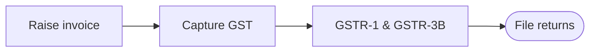

### 12.1 Automatic GST Computation

The system automatically determines GST treatment:
- **Intra-state** (same state): CGST + SGST
- **Inter-state** (different state): IGST
- **Unregistered vendor**: Reverse Charge Mechanism (RCM)

GST rates are derived from the HSN code linked to items.

### 12.2 GST Reports

| Report | Path | Description |
|--------|------|-------------|
| GST Input Register | Financial Accounting > GST & Tax Reports | All input tax credits |
| GST Output Register | Financial Accounting > GST & Tax Reports | All output tax collected |
| GSTR-1 | Financial Accounting > GST & Tax Reports | B2B, B2CL, B2CS breakdowns |
| GSTR-3B Summary | Financial Accounting > GST & Tax Reports | Monthly return summary |
| GSTR-2B Reconciliation | Financial Accounting > GST & Tax Reports | Match with vendor filings |

### 12.3 Credit/Debit Notes

For post-billing adjustments:

1. Navigate to **Financial Accounting > Credit/Debit Notes**
2. Select type: **Credit Note** (customer) or **Debit Note** (vendor)
3. Link to original invoice (optional)
4. Enter adjustment amount, GST breakup
5. System auto-creates the accounting voucher with correct GST ledger postings

### 12.4 TDS Register

View all TDS deductions made on purchases:

1. Navigate to **Financial Accounting > GST & Tax Reports > TDS Register**
2. Filter by period, section, vendor
3. Export for TDS return filing

### 12.5 TCS Register

View all TCS collected on sales:

1. Navigate to **Financial Accounting > GST & Tax Reports > TCS Register**
2. Filter by period and section

---

## 13. Fixed Assets & Depreciation

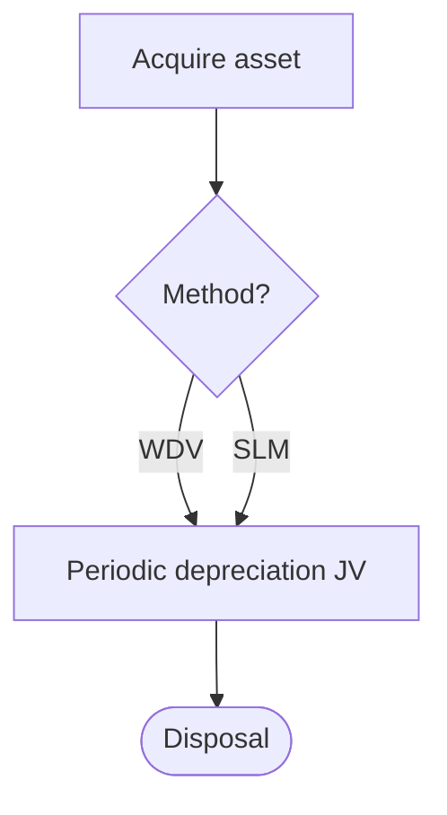

### 13.1 Asset Master

Register fixed assets (computers, furniture, vehicles, etc.):

1. Navigate to **Financial Accounting > Fixed Assets > Asset Master**
2. Click **Add Asset**
3. Fill in details:
   - Asset code, name, description
   - Purchase date and cost
   - Residual/salvage value
   - Depreciation method: **WDV** (Income Tax Act) or **SLM** (Companies Act)
   - IT Block Category (Computer 40%, Furniture 10%, Vehicle 15%, etc.)
   - Rate or useful life

### 13.2 Depreciation Worksheet

Generate and approve depreciation:

1. Navigate to **Financial Accounting > Fixed Assets > Depreciation Worksheet**
2. Select period (from date, to date)
3. Click **Generate Suggestions**
4. Review calculated amounts for each asset
5. Override amounts if needed (e.g., half-year rule for IT Act)
6. **Approve** to create the depreciation voucher

### 13.3 FA Settings

Configure default ledgers per retail:

1. Navigate to **Financial Accounting > Fixed Assets > FA Settings**
2. Set default Depreciation Expense ledger
3. Set default Accumulated Depreciation ledger

---

## 14. Gold Scheme Management

The Gold Scheme module lets you run structured jewellery savings schemes for your customers — similar to the chit fund / gold purchase plan model used widely in the Indian jewellery trade. Customers pay monthly instalments and earn making-charge discounts when they eventually purchase jewellery.

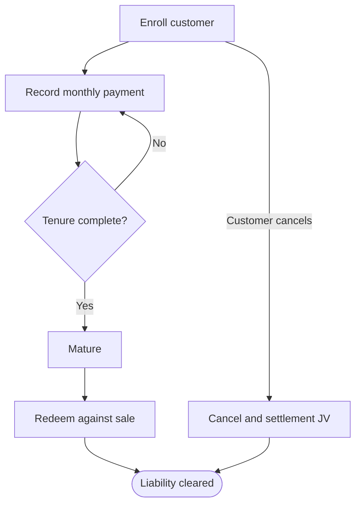

---

### 14.1 Overview: How It Works

1. **You create a Scheme Master** — defines the rules: tenure, installment range, gold price mode, and benefit tiers.
2. **A customer enrolls** — chooses the scheme, sets their monthly installment amount, and starts paying.
3. **You record a payment each month** — the system creates an accounting entry (SCHM voucher) automatically.
4. **On purchase**, the customer redeems their scheme benefit — a making charge discount is applied directly to their sales bill.

---

### 14.2 Navigating to the Gold Scheme Module

In the top navigation bar, click **Gold Schemes**. You will see three options:

| Menu Item | Path | Purpose |
|-----------|------|---------|
| **Dashboard** | Gold Schemes → Dashboard | Overview of all active enrollments, monthly collections, matured schemes |
| **Scheme Master** | Gold Schemes → Scheme Master | Create and manage scheme definitions |
| **Enrollments** | Gold Schemes → Enrollments | View and manage customer enrollments, record payments |

---

### 14.3 Creating a New Scheme (Scheme Master)

Navigate to **Gold Schemes → Scheme Master** and click **New Scheme**.

#### 14.3.1 Basic Fields

| Field | What to Enter | Example |
|-------|--------------|---------|
| **Scheme Code** | Short unique identifier. Used in receipts and enrollment numbers. | `GS-22K-11` |
| **Scheme Name** | Descriptive name visible to customers and staff. | `22K Gold Savings — 11 Month` |
| **Scheme Type** | One of three types — see Section 14.4 below. | `Monthly Installment` |
| **Gold Price Mode** | How the gold value is calculated at redemption — see Section 14.5. | `Current price at redemption` |
| **Tenure (months)** | Number of installments the customer must pay. Standard industry practice is **11 months** — the 12th month's equivalent is given as a benefit by the jeweller. | `11` |
| **Min Amount (₹)** | Minimum installment a customer can pay per month. | `₹1,000` |
| **Max Amount (₹)** | Maximum installment. Leave blank for no upper limit. | `₹50,000` or blank |
| **Accumulation Purity** | Only relevant for the **Gold Accumulation** scheme type. Specifies the gold purity (e.g. 22K) at whose rate each payment is converted to grams. See Section 14.5.2. | `22K` |
| **Diamond ornament benefits** | Tick this if the scheme should also offer discounts on diamond jewellery purchases, not just gold. Enables diamond-specific benefit tiers. | Checked / Unchecked |
| **Description** | Free-text description shown to customers. | `Pay ₹5,000/month for 11 months and get 75% off making charges on 22K gold.` |

#### 14.3.2 Benefit Tiers

Benefit tiers define **what discount the customer earns based on how many months they have paid**. Click **Add Tier** to add rows.

Each tier has:

| Column | Meaning |
|--------|---------|
| **Type** | `Gold` — discount on gold ornament making charges. `Diamond` — discount on diamond ornament making charges + product value. |
| **From (months)** | Minimum months completed to qualify for this tier. |
| **To (months)** | Maximum months this tier applies to. |
| **LC Discount %** | Percentage discount on Labour Charges / Making Charges. |
| **Value Discount %** | Percentage discount on the product value itself (used only for diamond tiers). |

**Example: Standard 11-month gold scheme with three tiers**

| Type | From | To | LC Discount % | Value Discount % |
|------|------|----|---------------|-----------------|
| Gold | 6 | 8 | 40% | 0% |
| Gold | 9 | 10 | 60% | 0% |
| Gold | 11 | 11 | 75% | 0% |

How to read this:
- A customer who has paid for **6, 7, or 8 months** gets **40% off making charges** when they purchase.
- At **9 or 10 months**, they get **60% off**.
- At exactly **11 months** (fully paid), they get **75% off making charges** — effectively receiving one free month.

**Example: Scheme with diamond benefit enabled**

| Type | From | To | LC Discount % | Value Discount % |
|------|------|----|---------------|-----------------|
| Gold | 6 | 8 | 40% | 0% |
| Gold | 9 | 11 | 75% | 0% |
| Diamond | 9 | 11 | 50% | 5% |

A fully paid customer buying a diamond piece gets 50% off diamond making charges AND 5% off the stone/product value.

> **Note:** A scheme can have either Gold tiers only, or both Gold and Diamond tiers if `Diamond ornament benefits` is checked. Tiers do not overlap — use non-overlapping month ranges.

---

### 14.4 Scheme Types in Detail

#### INSTALLMENT — Monthly Fixed-Amount Savings

The most common type. The customer pays a fixed amount every month (e.g. ₹5,000) for 11 months, totalling ₹55,000. At redemption, they can purchase jewellery worth up to their total paid amount plus apply the making-charge discount.

- **Best for:** Customers who want a disciplined savings plan with a predictable benefit.
- **Gold price at redemption:** Determined by the Gold Price Mode (see 14.5).

#### ACCUMULATION — Gold Gram Savings

Each payment is converted to **gold grams at the prevailing rate on that payment date**, and added to the customer's running gold balance. By the end of the scheme, the customer holds a fixed number of grams, not a fixed rupee amount. The value at redemption is therefore the current gold price × accumulated grams.

- **Best for:** Customers who want to accumulate physical gold weight and are comfortable with price movement.
- **Accumulation Purity:** You must set this field (e.g. 22K). When a ₹5,000 payment is recorded and 22K gold is at ₹6,200/g, the system adds `5000 ÷ 6200 = 0.806g` to the customer's gold balance.
- The accumulated grams are shown in the enrollment statement and on the dashboard.

#### LUMPSUM — One-Time Payment

The customer pays the entire amount in one go. The gold rate is **locked at enrollment time** — regardless of how gold prices move later. This is used for customers who want to pre-book jewellery at today's rate.

- **Best for:** Advance bookings, exhibition sales, bulk corporate gifting.
- **Locked rate:** Stored against the enrollment; visible in the statement.

---

### 14.5 Gold Price Modes

This setting controls how the rupee value of the scheme is translated into gold when the customer redeems.

| Mode | How It Works | When to Use |
|------|-------------|-------------|
| **Current price at redemption** | The gold rate on the date of purchase is used. Customer bears market risk — they may get less gold if prices have risen. | Standard installment schemes |
| **Gold accumulated at each payment rate** | Each payment buys gold at that day's rate (same as ACCUMULATION type). Total gold fixed in grams. | Gold accumulation schemes |
| **Gold price locked at enrollment** | Rate fixed when the customer enrolls. Customer is protected from price rises. | Lumpsum / advance booking schemes |

#### 14.5.1 Why Gold Price Mode Matters at Redemption

Suppose a customer paid ₹55,000 over 11 months:

- **CURRENT mode:** Gold is ₹7,000/g on purchase day → customer gets ₹55,000 ÷ 7,000 = **7.857g worth of ornaments**.
- **LOCKED mode (enrolled at ₹6,000/g):** Customer gets ₹55,000 ÷ 6,000 = **9.167g worth** — protected against the price rise.

#### 14.5.2 What is Accumulation Purity and Where Is It Used?

**Accumulation Purity** is the gold purity standard against whose daily market rate each payment is converted to grams. It is only relevant when the scheme type is **ACCUMULATION**.

**Where it is used:**
1. When a payment is recorded for an ACCUMULATION scheme, the system looks up the **today's gold rate for the selected purity** from the Gold Rate master.
2. It divides the payment amount by that rate to get the grams added: `grams = amount ÷ rate_per_gram`.
3. The grams are added to the `gold_accumulated_wt` field on the enrollment.
4. The payment record stores the `gold_rate_at_payment` and `gold_weight_added` for full traceability.
5. These accumulated grams are shown in the **Enrollment Statement** and on the **Dashboard**.
6. At redemption, the customer's entitlement is expressed in grams (not rupees), so they know exactly how much gold they have saved regardless of current prices.

**Example:**
- Scheme: ACCUMULATION, Purity = 22K, Installment = ₹5,000/month
- Month 1: 22K rate = ₹6,000/g → adds 0.833g
- Month 2: 22K rate = ₹6,200/g → adds 0.806g
- Month 3: 22K rate = ₹6,500/g → adds 0.769g
- After 3 months: **2.408g accumulated**, regardless of current price.

> **Setup requirement:** For ACCUMULATION schemes, gold rates for the selected purity must be entered in the Gold Rate master on each payment date. If the rate is missing, the system cannot calculate grams.

---

### 14.6 Enrolling a Customer

Navigate to **Gold Schemes → Enrollments** and click **New Enrollment**.

| Field | Notes |
|-------|-------|
| **Scheme** | Select from active schemes. The tenure and min/max amounts are shown below the selection. |
| **Customer** | Type at least 2 characters to search **existing customer ledgers** by **name or mobile number**. Only ledgers with the **Customer (CO)** role appear. Select from the dropdown; each result shows `Name — Mobile`. The scheme is always tied to a real customer ledger in your accounts — it is never a standalone record. |
| **Monthly Installment (₹)** | The fixed amount the customer will pay each month. Must be within the scheme's min/max range. For LUMPSUM schemes, this is the one-time amount. |
| **Start Date** | Defaults to today. The maturity date is auto-calculated as start date + tenure months. |
| **Remarks** | Optional internal notes. |

#### KYC (PAN & Aadhaar) — required to enrol

Enrolment in a scheme requires the customer's **PAN and Aadhaar** on record. When you select a customer:

- If their ledger **already has** PAN and Aadhaar, no extra fields appear.
- If either is **missing**, a **"KYC details required"** panel appears asking for the missing value(s). PAN must look like `ABCDE1234F`; Aadhaar must be 12 digits.
- On save, the captured PAN/Aadhaar is written **back to the customer's ledger** (so it only ever has to be entered once), and then the enrolment proceeds.

#### Nominee details — required

Every enrolment captures one **nominee**:

| Field | Required | Notes |
|-------|----------|-------|
| **Name** | Yes | Nominee's full name. |
| **Mobile** | Yes | Nominee's contact number. |
| **Relationship** | Yes | Spouse, Son, Daughter, Father, Mother, Brother, Sister, or Other. |
| **Address** | Optional | Nominee's address. |

The nominee is stored against this specific enrolment (one nominee per enrolment).

#### Enrollment form upload — optional

You may attach a scan of the **signed enrolment form** (PDF, JPG, or PNG, up to 10 MB). This is optional — the enrolment can be saved without it and the file added later.

After saving, the enrollment is created with status **ACTIVE** and an enrollment number (e.g. `SCHM-E/R001/26-27/00001`). A per-customer scheme liability sub-ledger is also created automatically — see **14.12 Scheme Accounting Structure**.

---

### 14.7 Recording a Payment (Receipt Entry)

Go to **Gold Schemes → Enrollments**. Find the customer's enrollment in the list. Only **ACTIVE** enrollments show the payment button.

Click the **green credit card icon** (Record Payment) on the row.

| Field | Notes |
|-------|-------|
| **Amount (₹)** | Pre-filled with the scheme's installment amount. Can be changed if the customer pays a different amount. |
| **Date** | Defaults to today. |
| **Payment Mode** | Cash, Bank Transfer, UPI, Cheque, or Card. |
| **Payment Account** | Select the cash or bank ledger that received the money (e.g. "Main Cash", "HDFC Current A/c"). |
| **Remarks** | Optional. |

On save:
- A **SCHM accounting voucher** is auto-created: **Dr Cash/Bank → Cr the customer's scheme sub-ledger** (`Scheme A/c — <Customer> (<Enrollment No>)`). The bank/cash book reflects the receipt exactly as entered. See **14.12 Scheme Accounting Structure** for how this rolls up.
- The payment count and total paid on the enrollment are updated.
- For ACCUMULATION schemes, gold grams are calculated and added to `gold_accumulated_wt`.
- You are redirected to the **Enrollment Statement** which shows all payment history.

---

### 14.8 Enrollment Statement

Click the **eye icon** on any enrollment row to open the statement. It shows:

- Enrollment summary: scheme, customer, start/maturity dates, installment amount, total paid, payments made.
- **Gold Accumulated** (grams) — shown for ACCUMULATION schemes.
- **Locked Gold Rate** — shown for LOCKED price mode schemes.
- **Current Benefit** — the active making-charge discount tier based on months completed (e.g. "75% off Making Charges — Tier 11m").
- Full payment history table with date, amount, mode, account, and gold grams per payment.

---

### 14.9 Enrollment Statuses

| Status | Meaning |
|--------|---------|
| **ACTIVE** | Payments ongoing. Record Payment button is available. |
| **MATURED** | All installments completed (maturity date reached). Awaiting redemption. |
| **REDEEMED** | Customer has purchased jewellery and the scheme benefit has been applied. |
| **CANCELLED** | Enrollment closed before redemption. Any amount the customer paid in is settled back to them — either refunded or transferred to their ledger as credit. See Section 14.12. |

> **Note on cancellation:** A scheme deposit can never be retained by the shop on cancellation — that is not permitted under law. The system therefore only allows a **refund** or a **transfer to the customer's ledger**; it does not offer a forfeiture option.

---

### 14.10 Customer Portal

Customers can check their own scheme status without calling the shop:

- Access via the portal link provided by the jeweller.
- View enrollment details, payment history, accumulated gold weight, and applicable benefits.
- Cannot make payments through the portal — only view access.

---

### 14.11 Gold Scheme Dashboard

Navigate to **Gold Schemes → Dashboard** for a live operational overview of your entire scheme portfolio. The dashboard is designed for daily use — it tells you what needs attention today, what is coming up, and what regulatory deadlines are approaching.

The page refreshes its data automatically every 60 seconds. After recording a payment or enrolling a new customer, the dashboard updates within one minute.

---

#### 14.11.1 KPI Strip

Six headline cards appear at the top of the page:

| Card | What It Shows |
|------|--------------|
| **Active** | Total enrollments currently in ACTIVE status (paying customers). |
| **Total Collection** | Cumulative amount received across all scheme payments since inception. Shown in compact format (e.g. ₹4.20L, ₹1.25Cr). |
| **Due This Month** | Total installment amount expected this month, with a count of how many individual installments are due. |
| **Maturing This Month** | Number of enrollments reaching their maturity date this calendar month, with a sub-line showing how many mature within the next 7 days. |
| **Overdue Matured** | Enrollments that have passed their maturity date but have not yet been redeemed by the customer. These need follow-up. |
| **Aged >365 Days** | Enrollments where the customer's first payment is older than 365 days and the scheme has not been redeemed or cancelled. See Section 14.11.5 for why this matters. |

---

#### 14.11.2 Collections by Payment Mode — This Month

Below the KPI strip, a horizontal bar shows how collections this month are split by payment method:

- Cash, Bank Transfer, UPI, Cheque, Card
- Each mode shows the total amount and its percentage share of this month's collections
- Use this to reconcile day-end cash counts against scheme receipts, and to verify bank deposits match UPI + Cheque + Bank totals

---

#### 14.11.3 Aged Advances — Regulatory Alert (Red Banner)

> **Legal requirement:** Under the Jewellery (Making, Selling and Trading) regulations in India, a jeweller cannot hold a customer's advance for more than 365 days without delivering goods or returning the money.

The red banner at the top of the dashboard lists every enrollment where the **first payment received is older than 365 days** and the scheme has not been redeemed or cancelled. Each row shows:

| Column | Meaning |
|--------|---------|
| **Enrollment** | Enrollment number — click Open to view the full record. |
| **Customer** | Customer name and phone number. |
| **First Payment** | Date of the earliest payment received. |
| **Days Held** | How many days have elapsed since that first payment (highlighted in red if it exceeds 365). |
| **Total Collected** | Sum of all payments received for this enrollment. |

**Action required:** For each flagged enrollment you must either:
1. Arrange the customer's redemption (purchase jewellery and apply the benefit), or
2. Refund the customer and cancel the enrollment.

If the banner shows no rows, a green message appears: *"No aged advances. All customer balances within policy."*

---

#### 14.11.4 Installment Dues Section

This section shows which customers owe an installment payment. Use the tab strip to switch between three views:

| Tab | Shows |
|-----|-------|
| **Overdue** | Customers whose next installment was due in a previous month and has not been paid. Sorted by most overdue first. |
| **Next 7 Days** | Customers whose next installment falls within the coming week. Use this to send reminders or call the customer. |
| **This Month** | All customers with an installment due before month-end. |

Each row in the table shows the enrollment number, customer name, phone number, installment amount, computed next-due date, and a progress counter (e.g. *4 / 11* meaning 4 months paid out of 11 total).

> **How the due date is calculated:** The system uses the customer's enrollment start date as the anchor day. If a customer enrolled on the 15th of a month, their installment is due on the 15th of every subsequent month. Payments already recorded for the month shift the next-due forward by one month automatically.

> **Note:** Only INSTALLMENT-type schemes appear in this section. ACCUMULATION and LUMPSUM schemes do not have monthly due dates.

---

#### 14.11.5 Maturing Schemes Section

This section shows enrollments approaching their maturity date. Switch between two windows:

| Tab | Shows |
|-----|-------|
| **Next 7 Days** | Enrollments that mature within the coming week. Plan redemption calls for these customers now. |
| **This Month** | All enrollments maturing before month-end. |

Columns shown: enrollment number, customer, scheme name, maturity date, and total amount accumulated.

When a customer's scheme matures, the enrollment status changes to **MATURED** automatically. At that point, the customer should be contacted to come in and purchase jewellery using their accumulated benefit.

---

#### 14.11.6 Matured & Awaiting Redemption

This table lists all enrollments in **MATURED** status — schemes that have completed their tenure but have not yet been redeemed. Each row shows how many days have passed since the maturity date.

| Column | Meaning |
|--------|---------|
| **Enrollment** | Enrollment number. |
| **Customer** | Customer name. |
| **Matured On** | Date the scheme reached its tenure. |
| **Days Past Due** | Days elapsed since maturity. Shown in red as a reminder. |
| **Accumulated** | Total amount (or gold grams for ACCUMULATION) built up. |
| **Open** | Button to go directly to the enrollment's payment/redeem screen. |

Schemes that sit here for too long will eventually appear in the **Aged Advances** regulatory alert once the 365-day clock is passed.

---

### 14.12 Scheme Accounting Structure

Gold schemes are **fully integrated with the accounting system** — they are not a separate silo. Money a customer pays into a scheme is an **advance against a future purchase**, so it is held as a **current liability** (money the shop owes the customer in goods), tracked per customer.

#### How the ledgers are organised

- A single account group, **Scheme Advances** (under *Current Liabilities*), holds all scheme money.
- When a customer is enrolled, the system **auto-creates one sub-ledger per enrolment**, named `Scheme A/c — <Customer> (<Enrollment No>)`, inside the Scheme Advances group. These are **system ledgers** — they cannot be hand-edited or deleted.

```
Current Liabilities
└── Scheme Advances                 ← single line on the Trial Balance
    ├── Scheme A/c — Abha Lunia (SCHM-E/.../00001)
    ├── Scheme A/c — Ramesh Shah (SCHM-E/.../00002)
    └── ... one per active enrolment
```

#### What each entry does

| Event | Accounting entry |
|-------|------------------|
| **Payment received** | **Dr** Cash/Bank · **Cr** `Scheme A/c — <Customer>` (that enrolment's sub-ledger) |
| **Redemption** (customer buys jewellery) | Sales invoice debits the customer's normal trade ledger; a settlement journal then posts **Dr** `Scheme A/c — <Customer>` · **Cr** customer's trade ledger, applying the scheme balance against the purchase. The scheme sub-ledger returns to zero. |
| **Cancellation** (before redemption) | A settlement journal clears the sub-ledger back to the customer — **Dr** `Scheme A/c — <Customer>` · **Cr** Cash/Bank (refund) *or* the customer's trade ledger (transfer to credit). The scheme sub-ledger returns to zero. |

#### What you see in reports

- **Bank / Cash Book** — every receipt appears at full value, exactly as entered.
- **Trial Balance** — the Scheme Advances group shows as **one line** with the firm-wide scheme float; drill in to see each customer's balance.
- **Customer's scheme statement** — the sub-ledger *is* the customer's scheme passbook: every receipt and the final redemption, in date order.

#### How a scheme links back to the customer

The scheme sub-ledger and the customer's normal trade ledger are **deliberately separate accounts** (a liability vs. a receivable — they must not be mixed on the balance sheet), but they are **permanently linked through the enrolment record**, which stores both the customer's trade ledger and the scheme sub-ledger. The system always knows they are the same person by this link — never by matching names — so two customers with the same name are never confused. The sub-ledger also carries the customer's mobile and PAN for easy human cross-reference.

#### Cancelling an enrollment

Open the enrollment's statement and click **Cancel Enrollment**. If the customer has paid anything in, a dialog asks how to settle that money:

| Option | What happens | When to use |
|--------|--------------|-------------|
| **Refund to cash/bank** | The amount is paid back to the customer; the system posts **Dr** scheme sub-ledger · **Cr** the cash/bank account you choose. | The customer wants their money returned. |
| **Transfer to customer** | The amount moves onto the customer's normal trade ledger as a credit they can use against a future purchase; **Dr** scheme sub-ledger · **Cr** customer trade ledger. | The customer will keep shopping and wants the balance held to their account. |

Either way the scheme sub-ledger is cleared to zero. If no payments were made, the enrollment is simply cancelled with no accounting entry.

> **Forfeiture is not offered.** Retaining a customer's scheme deposit is not permitted under law, so the shop can never keep the money — only refund or transfer it.

#### Telling the two ledgers apart in reports

Because every scheme customer now has two accounts that share the same name (their trade ledger and their `Scheme A/c — …` sub-ledger), the **Ledger Statement** search tags each scheme sub-ledger with an amber **"Scheme A/c"** badge. When you want the customer's *sales/purchase* statement, pick the plain trade-ledger row; when you want their *scheme passbook*, pick the badged row.

> **Migrating existing data:** if you have schemes that were recorded before this structure existed, run `python manage.py backfill_scheme_subledgers` once. It creates the missing per-customer sub-ledgers and moves historical balances onto them. It is safe to run more than once.

---

## 15. HR & Payroll

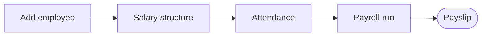

### 15.1 Employee Setup

1. Navigate to **HR > Employees**
2. Click **Add Employee**
3. Fill in:
   - Employee code, full name
   - Designation, department
   - Date of joining
   - Bank details (for salary transfer)
   - PAN, PF number, ESI number
4. System creates a linked Django user account

### 15.2 Salary Structure

The Salary Structure defines what each employee earns each month. Set it up once; it is reused every payroll cycle.

**Step-by-step:**

1. Navigate to **HR > Salary Structure**
2. Click **Add / Edit** against an employee (or click the employee's name)
3. Fill in the monthly earnings:

| Component | How to enter |
|-----------|-------------|
| **Basic Salary** | Fixed monthly amount (e.g., ₹15,000) |
| **HRA** (House Rent Allowance) | Typically 40–50% of Basic; enter as a fixed amount |
| **DA** (Dearness Allowance) | Fixed amount or % of Basic |
| **Conveyance Allowance** | Fixed monthly amount (standard ₹1,600 is tax-exempt) |
| **Medical Allowance** | Fixed monthly amount (₹1,250/month is tax-exempt) |
| **Special Allowance** | Any additional fixed pay component |

4. **Effective Date**: Enter the date from which this structure applies. If you revise salary mid-year, add a new structure with the new date — previous structures are preserved for audit.
5. Click **Save**

> The sum of all earnings = **Gross Salary**. PF, ESI, PT, and TDS are calculated on top of this in Section 15.3.

### 15.3 Deduction Configuration

Deductions are configured per employee and applied automatically during salary processing.

**Step-by-step:**

1. Navigate to **HR > Deductions** (or the Deductions tab inside the employee record)
2. Configure each applicable deduction:

| Deduction | Rate / Rule | Notes |
|-----------|------------|-------|
| **PF (Provident Fund)** | 12% of Basic (employee) + 12% employer | Basic capped at ₹15,000 for statutory rate. If employee opts for PF on full salary, remove the cap. |
| **ESI (Employee State Insurance)** | 0.75% of Gross (employee) + 3.25% employer | Applies only if Gross Salary < ₹21,000/month |
| **Professional Tax** | State-specific slab | Maharashtra: ₹200/month for salaries > ₹10,000. Enter the applicable monthly amount. |
| **TDS (Income Tax)** | Monthly deduction based on annual projected income | Enter the monthly TDS amount (calculate outside using the income tax slab); the ERP deducts the entered amount |
| **Advance Recovery** | Fixed EMI per month | Enter the monthly installment to recover against a salary advance given to the employee |
| **LWP (Leave Without Pay)** | Calculated during processing | Not configured here — entered as "days absent" during salary processing |

3. Click **Save Deductions**

> **Employer contributions** (PF, ESI employer share) are shown on the payslip for reference but are not deducted from the employee's net pay. They are posted as an expense in the accounting entry.

### 15.4 Salary Processing

Run salary processing at the end of each month.

**Step-by-step:**

1. Navigate to **HR > Salary Processing**
2. Click **New Payroll Run**
3. Select:
   - **Month**: The payroll month (e.g., May 2026)
   - **Retail Location**: The branch for which you are running payroll
4. Click **Generate Slips** — the system creates a draft payslip for every active employee
5. Review each generated slip:
   - Click on an employee row to open their draft slip
   - **Days Worked**: Enter the actual number of days worked. The system prorates earnings: `Gross × (Days Worked / Working Days in Month)`
   - **Days Absent (LWP)**: Days absent without approved leave — automatically reduces proportional salary
   - **Additional Earnings**: Enter any one-time bonus, overtime, or allowance for this month
   - **Additional Deductions**: Enter any one-time recovery or adjustment
   - The **Net Salary** updates as you make changes
6. Once all slips are reviewed, click **Approve All** (or approve individually)
7. On approval, the system:
   - Locks the payslips (no further editing)
   - Creates a **SLRY voucher** with the accounting entry:
     - **Dr** Salary Expense A/c (gross salary)
     - **Dr** PF Expense A/c (employer's PF share)
     - **Cr** Employee Payable A/c (net salary payable to employees)
     - **Cr** PF Payable A/c (both employee + employer PF)
     - **Cr** ESI Payable A/c
     - **Cr** PT Payable A/c
     - **Cr** TDS Payable A/c
8. **Pay employees**: After approving, use a **Payment Voucher** to pay each employee:
   - **Dr** Employee Payable A/c → **Cr** Bank / Cash
9. Click **Print Payslips** to print or share payslips with employees

### 15.5 Leave Management

Track employee leave balances within the ERP.

#### Configuring Leave Types

1. Navigate to **HR > Leave Types**
2. Default types: Casual Leave (CL), Earned Leave (EL), Sick Leave (SL)
3. Edit or add leave types, setting the **Annual Entitlement** per type (e.g., CL: 12 days/year)

#### Opening Leave Balances

At the start of a new year (or when setting up a new employee):

1. Navigate to **HR > Leave Balances**
2. Select the employee
3. Enter the opening balance for each leave type
4. Click **Save**

#### Viewing Leave Balances

1. Navigate to **HR > Leave Balances**
2. Select the employee and leave type (Casual Leave, Earned Leave, Sick Leave, etc.)
3. The screen shows: opening balance, leaves taken, current balance

#### Recording Leave Taken

Leave taken is factored into salary calculation:

- When generating a salary slip (Section 15.4), enter the number of **days worked** for the month
- For **LWP** (Leave Without Pay): enter the days absent — proportional salary deduction is automatic
- For **paid leave** (CL/EL): the system deducts from the leave balance but does NOT reduce salary

> **Important**: Formal leave application workflows (leave requests, manager approvals) are managed outside the ERP. The ERP records the outcome — days worked — for payroll purposes only. Update leave balances manually when leave is sanctioned.

### 15.6 HR Settings

Configure accounting ledgers for salary posting:
- Salary Expense Ledger
- Employee Payable Ledger
- PF/ESI/PT/TDS Payable Ledgers

---

## 16. Reports

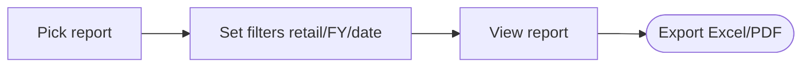

### 16.1 Financial Reports

#### How to Run Financial Reports

1. Navigate to **Financial Accounting > Reports** (or use the shortcut under the Reports menu)
2. Select the report from the list below
3. Set the **Fiscal Year** and **Date Range** filters
4. Click **Generate / Run**
5. Use the **Print** button or **Export to Excel/PDF** as needed

| Report | Path | Description | Key Filters |
|--------|------|-------------|-------------|
| **Trial Balance** | Finance Reports | All ledger balances (Debit/Credit) — use to verify books balance | As-of date, FY |
| **Balance Sheet** | Finance Reports | Assets = Liabilities + Capital; see the overall financial position | As-of date |
| **Profit & Loss** | Finance Reports | Income − Expenses = Net Profit/Loss for the period | Date range |
| **P&L Calculation** | Finance Reports | Detailed P&L including opening/closing stock valuation | Date range |
| **Financial Ratios** | Finance Reports | Current ratio, quick ratio, gross margin, etc. | FY |
| **Cash Book** | Finance Reports | All cash receipts and payments, running balance | Date range, Cash ledger |
| **Bank Book** | Finance Reports | All bank transactions, running balance | Date range, Bank ledger |
| **Day Book** | Finance Reports | All vouchers posted on a specific date — useful for daily reconciliation | Date |
| **Gold Ledger Balances** | Finance Reports | Gold weight balances (grams) per ledger account | As-of date |
| **GSTR-2B Reconciliation** | Finance Reports > GST | Match vendor GST filings vs. your purchase ITC records | Month |
| **Gold Rate History** | Setup > Gold Rates | Historical buying and selling rates by date | Date range |

> **Trial Balance first**: Always run the Trial Balance before generating Balance Sheet or P&L — if TB doesn't balance (Debit ≠ Credit), there is a data entry error that will corrupt the other reports.

### 16.2 Sales Reports

#### How to Run Sales Reports

1. Navigate to **Sales > Reports**
2. Select the report, set the date range, and click **Run**

| Report | Description | Key Filters | Common Use |
|--------|-------------|------------|------------|
| **Salesperson Commission** | Commission earned per salesperson for the period | Date range, Salesperson | Month-end payouts |
| **GST Invoice Register** | All sales invoices with CGST/SGST/IGST breakup | Date range | GSTR-1 filing |
| **Cheque Deposit Status** | Cheques received, deposited, cleared, bounced | Date range, Status | Daily banking follow-up |
| **Delivery Tracking** | Delivery status per invoice | Date range, Status | Customer delivery follow-up |
| **Advance Received** | Advance payments collected vs. adjusted against orders | Date range | Identify unadjusted advances |

> **For GSTR-1**: Run the GST Invoice Register for the filing month, cross-check totals against your GSTN portal before filing.

### 16.3 Inventory Reports

#### How to Run Inventory Reports

1. Navigate to **Inventory > Reports**
2. Select the report, apply filters, and click **Run**

| Report | Description | Key Filters | Common Use |
|--------|-------------|------------|------------|
| **Stock Report** | All barcodes currently in stock with weight, purity, value | Item type, Purity, Location | Daily stock check |
| **Closing Stock Valuation** | Total stock value as of a date (for accounting/P&L) | As-of date | Month-end closing |
| **Metal Report** | Gold/silver weight totals by item and purity | Date range | Reconcile against physical stock |
| **Packetwise Stone** | Stone inventory by packet — pieces and carats on hand | Packet group | Stone reconciliation |
| **Raw Material Balance** | Unmanufactured gold/silver on hand by purity | As-of date | Check material for new orders |
| **Raw Material Ledger** | Transaction-by-transaction history for raw material | Ledger, Date range | Audit trail for material movements |
| **Semi-Finished Stock** | Items currently with karigars (issued but not received) | Karigar | Follow-up on outstanding job work |
| **ItemWise Barcode** | Barcodes grouped by item type with count and weight | Item | Count pieces by category |
| **Barcode Split/Merge** | History of all split and merge operations | Date range | Audit trail for altered barcodes |

> **Month-end procedure**: Run **Closing Stock Valuation** on the last day of the month and save the export. This value feeds into the P&L Calculation report as closing stock.

### 16.4 Purchase Reports

#### How to Run Purchase Reports

1. Navigate to **Purchases > Reports**
2. Select the report, set the date range, and click **Run**

| Report | Description | Key Filters | Common Use |
|--------|-------------|------------|------------|
| **Purchase Register** | All purchase vouchers with vendor, amount, GST breakup | Date range, Vendor | Month-end reconciliation with vendors |
| **Vendor Outstanding** | Unpaid vendor bills and their age | As-of date, Vendor | Follow up on payables |
| **Purchase Order Status** | Open POs — ordered vs. received per line item | Date range, Karigar | Follow up on pending manufacturing |
| **TDS Deducted** | TDS deducted across purchase vouchers | Date range, Section | TDS return filing (Form 26Q) |
| **RCM Liability** | GST payable under reverse charge | Date range | File GST on RCM |
| **Karigar-wise Purchase** | Total purchases per karigar for the period | Date range, Karigar | Karigar payment reconciliation |

> **For GSTR-2**: Run the Purchase Register for the month, cross-check ITC totals before filing your GSTR-2B reconciliation (Section 16.1 → GSTR-2B Reconciliation).

### 16.5 Gold Scheme Reports

#### How to Run Gold Scheme Reports

1. Navigate to **Gold Schemes > Reports**
2. Select the report, set filters, and click **Run**

| Report | Description | Key Filters | Common Use |
|--------|-------------|------------|------------|
| **Scheme Dashboard** | Live operational overview — dues, maturities, overdue, aged advances, payment mode mix. See Section 14.11. | — | Daily operations, morning review |
| **Maturity Calendar** | Enrollments maturing within a date range | Date range | Plan redemption conversations for the month |
| **Collection Report** | Installment payments received, breakable by payment mode | Date range, Scheme | Monthly collection review; bank reconciliation |
| **Enrollment Summary** | Count of Active, Matured, Redeemed, and Cancelled enrollments | FY, Scheme | Board-level scheme performance review |
| **Customer Scheme Statement** | Full payment history for a specific customer's enrollment | Customer, Enrollment No | Customer service — "How many installments have I paid?" |

> **Monthly collection workflow**: Run the Collection Report for the month, filter by payment mode to verify that cash/bank totals match your bank statement and cash book.

### 16.6 HR Reports

#### How to Run HR Reports

1. Navigate to **HR > Reports**
2. Select the report, set the month/year, and click **Run**

| Report | Description | Key Filters | Common Use |
|--------|-------------|------------|------------|
| **Employee List** | All active employees with designation and joining date | Status (Active/Inactive) | Staff directory, audit |
| **Payslip Register** | Month-wise salary paid to all employees | Month, Year | Payroll audit, salary disbursement tracking |
| **PF / ESI Summary** | Statutory deduction totals — employee + employer contributions | Month, Year | PF/ESI challan payment and filing |
| **Professional Tax Register** | PT deducted per employee per period | Month, State | PT challan payment |

> **For PF/ESI filing**: Run the PF/ESI Summary for the month, use the totals to fill the ECR (Electronic Challan cum Return) on the EPFO portal. PT should match the Professional Tax Register before challan payment.

### 16.7 Manufacturing Reports

#### How to Run Manufacturing Reports

1. Navigate to **Manufacturing > Reports**
2. Select the report, apply filters, and click **Run**

| Report | Description | Key Filters | Common Use |
|--------|-------------|------------|------------|
| **Job Work Status** | Outstanding gold and items with each karigar | Karigar, Date range | Daily karigar follow-up; identifies items not returned |
| **Karigar Stone Transactions** | Stone issue and return per karigar | Karigar, Date range | Stone accountability — matches issued vs. returned carats |
| **Hallmark Issue/Receive** | Status of items sent for hallmarking | Status, Date range | Follow up on items pending HUID assignment |
| **Finished Item Receive** | Items received from karigars with weight details | Karigar, Date range | Manufacturing inward register |
| **Refinery Report** | Gold sent to refinery and returns | Date range | Reconcile refined gold received vs. issued |
| **Repair Job Status** | Open and closed repair job cards | Status, Date range | Customer follow-up on pending repairs |

> **Daily use**: Run **Job Work Status** every morning to see gold balances with each karigar. Any item older than your standard manufacturing cycle needs immediate follow-up.

---

## 17. Settings & Administration

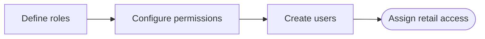

### 17.1 User Management

1. Navigate to **Settings > User Management**
2. Create, edit, or deactivate user accounts
3. Assign retail location access

### 17.2 Roles & Permissions

1. Navigate to **Settings > Roles & Permissions**
2. Create roles (Admin, Manager, Sales, Billing, Accounts, etc.)
3. Configure permissions per module:
   - Can View (GET)
   - Can List (LIST)
   - Can Create (POST)
   - Can Edit (PUT/PATCH)
   - Can Delete (DELETE)

### 17.3 Fiscal Year Management

Navigate to **Setup > Organisation > Fiscal Years**:

- **Create FY**: New fiscal year for a retail
- **Close FY**: Prevents new transactions (soft close)
- **Hard Close FY**: Prevents all changes including audit adjustments
- **Reopen FY**: Reverses a soft close
- **Sync Opening Balances**: Copies closing balances to the next FY as opening balances

### 17.4 Exhibition Mode

For temporary exhibitions/fairs at different venues:

1. Navigate to **Setup > Organisation > Exhibitions**
2. Create an exhibition profile:
   - Venue name, address, GSTIN (if different)
   - Activation dates
3. When active, the exhibition's GSTIN/address overrides the retail's defaults on all invoices

### 17.5 CRM Automation (WhatsApp)

Configure automated WhatsApp messages to keep customers informed without manual effort. Messages are triggered by events (sale saved, payment received, etc.).

#### Supported Providers

| Provider | Best For | Notes |
|----------|----------|-------|
| **Meta Cloud API** | Direct integration — no third-party | Requires a WhatsApp Business API account and approved templates |
| **WATI** | Managed WhatsApp inbox + automation | Subscription service; easier template management |
| **AiSensy** | Campaign management + chatbot | Subscription service |

#### Step-by-Step Setup

**1. Choose a provider and obtain API credentials**

- For **Meta Cloud API**: Set up a WhatsApp Business API account at [business.facebook.com](https://business.facebook.com), create a WhatsApp Business App, and get the **Phone Number ID** and **Access Token**
- For **WATI** or **AiSensy**: Sign up at their respective portals and obtain the **API Endpoint URL** and **API Key**

**2. Create and approve message templates**

WhatsApp requires pre-approved message templates for business-initiated messages:
- Log into your provider's portal and create a template for each event (sale, payment receipt, birthday, etc.)
- Templates must be approved by Meta before they can be used (typically 24–48 hours)
- Note down the **Template Name** for each approved template

**3. Configure the ERP**

1. Navigate to **Settings > CRM Automation**
2. Select your **Provider** from the dropdown
3. Enter the credentials:
   - **API Endpoint / Phone Number ID**: From your provider
   - **API Key / Access Token**: From your provider
4. Map each event to a template:

| Event | Template to Map | When It Fires |
|-------|----------------|---------------|
| **Sales Confirmation** | Your "sale_confirmation" template | When a Sales Voucher is saved |
| **Payment Receipt** | Your "payment_receipt" template | When a Receipt Voucher is saved |
| **Gold Scheme Payment** | Your "scheme_payment" template | When a Scheme Payment is recorded |
| **Scheme Maturity Alert** | Your "scheme_maturity" template | When an enrollment matures |
| **Birthday Greeting** | Your "birthday" template | Customer's birthday (if date stored in ledger) |
| **Anniversary Greeting** | Your "anniversary" template | Customer's anniversary (if date stored in ledger) |

5. Enter the template name for each event you want to enable, and toggle the event **ON**
6. Click **Save Settings**

**4. Testing**

1. Create a test sales voucher for a customer with a valid mobile number
2. Save the voucher
3. Check the customer's WhatsApp — the configured template message should arrive within 30 seconds
4. If the message does not arrive, check **Settings > CRM Automation > Message Logs** for error details

> **Important**: The mobile number used for WhatsApp messages is taken from the customer's ledger (**mobile1** field). Ensure all customer ledgers have a valid 10-digit mobile number starting with the country code (e.g., 91XXXXXXXXXX).

> **Template variables**: Templates use placeholders like `{{customer_name}}`, `{{amount}}`, `{{invoice_no}}`. The ERP fills these automatically from the transaction data — do not modify the placeholder names when creating templates.

### 17.6 Advanced Settings

Configure system-wide settings at **Settings > Settings**:

**Bill Calculation:**
- Bill total auto-calculation mode
- **GST Bill Number**: Toggle to enable automatic GST bill number generation on sales vouchers (see Section 7.5 for details)

**Search & Input:**
- **Spell Check & Fuzzy Search**: Enable or disable browser spell checking on address/notes fields and fuzzy matching in account group and picker searches (on by default)

**Storage Paths:**
- Attachment storage path
- Barcode image storage path

### 17.7 Licensing & Module Subscriptions

Jewel India ERP uses a module-based licensing model. Each company is subscribed to a set of modules (apps) and can activate them per their plan.

**Viewing your active modules:**

1. Navigate to **Settings > Licensing**
2. The screen shows all available modules with their status:
   - **Active**: Licensed and available for use
   - **Inactive**: Not included in your current plan

**What happens when a module is not licensed:**

- The module does not appear in the navigation menu
- Attempting to access the module's API returns a 403 error
- Existing data is preserved — licensing only controls access, not deletion

**Resource limits:**

Each subscription plan may enforce limits such as:
- Maximum number of users
- Maximum number of retail branches

Contact your vendor to upgrade or add modules to your subscription.

### 17.8 Database Backup

It is strongly recommended to take regular backups, especially for SQLite-based development setups.

**From the ERP UI:**

1. Navigate to **Settings > Backup**
2. Click **Download Backup**
3. The system generates a `.sqlite3` (dev) or `.sql` dump (PostgreSQL) and downloads it to your computer
4. Store backups in a secure, off-site location (e.g., Google Drive, external hard disk)

**Automated backup (production):**

For PostgreSQL in production, set up a scheduled `pg_dump` job:

```bash
pg_dump -U your_db_user your_db_name > backup_$(date +%Y%m%d).sql
```

Add this to a cron job (Linux) or Task Scheduler (Windows) to run nightly.

> **Warning:** A backup is only useful if you can restore it. Test restoration periodically.

### 17.9 Audit Log

Navigate to **Settings > Audit Log** to view:
- All data changes (create, update, delete)
- HTTP request history
- Login/logout events

---

## 18. Customer Portal

A separate web portal for customers to access their scheme information.

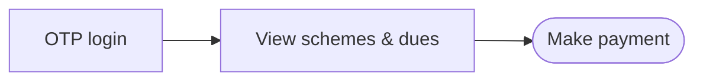

### Portal Access

- URL: `http://your-domain/portal/`
- Login via mobile number + OTP
- Or username/password (if configured)

### Portal Features

- View gold scheme enrollments
- Check payment history
- See accumulated gold weight
- View applicable discount benefits
- Download enrollment statements

---

## 19. Best Practices

### Data Entry Guidelines

1. **Always verify gold rates** before creating sales/purchase vouchers
2. **Scan barcodes** instead of manual entry wherever possible
3. **Allocate payments to specific bills** (don't leave as "on account" unless intentional)
4. **Record cash transactions immediately** — the system tracks daily/annual cash limits
5. **Close fiscal year promptly** after auditing — prevents back-dated entries

### Common Mistakes to Avoid

| Mistake | Impact | Prevention |
|---------|--------|------------|
| Creating vouchers outside the fiscal year | Reports will be inaccurate | System now validates FY boundaries |
| Not configuring GST ledgers before billing | GST won't be posted correctly | Setup wizard ensures this |
| Deleting barcodes instead of processing returns | Audit trail lost permanently | Use Sales/Purchase Return flows |
| Duplicate salary slip generation | Double payment | System enforces unique (employee, month, year) |
| Transferring stock without receiving at destination | Items stuck "in transit" forever | Follow up on all pending transfers |
| Ignoring TDS on large purchase payments | Compliance penalty | System auto-calculates when configured |

### Daily Checklist

- [ ] **Update gold rates** before creating any sales or purchase bills (**Setup > Gold Rates**)
- [ ] **Review Gold Scheme Dashboard** — check "Dues Today / 7 Days" tab for customers with installments due (**Gold Schemes > Dashboard**)
- [ ] **Check pending stock transfers** — receive any in-transit items from other branches (**Inventory > Stock Transfer**)
- [ ] **Review Job Work Status** — follow up on karigars with overdue items (**Manufacturing > Reports > Job Work Status**)
- [ ] **Verify cash book balance** matches physical cash in hand (**Finance Reports > Cash Book**)
- [ ] **Review outstanding cheques** — check for any cheques due for deposit or clearance (**Sales > Cheque Deposits**)
- [ ] **Back up the database** (critical for SQLite setups — **Settings > Backup > Download Backup**)

### Monthly Checklist

- [ ] **Process salaries** for all employees (**HR > Salary Processing**)
- [ ] **Pay PF/ESI challan** using the PF/ESI Summary report (**HR > Reports > PF / ESI Summary**)
- [ ] **Pay Professional Tax** challan (**HR > Reports > Professional Tax Register**)
- [ ] **Pay TDS collected** during the month (**Financial Accounting > Voucher Lists > Payment Voucher** → TDS Payable A/c)
- [ ] **Bank reconciliation** for all bank accounts (**Financial Accounting > Bank Reconciliation**)
- [ ] **Review and file GSTR-3B** using the GST Invoice Register and Purchase Register
- [ ] **Run Closing Stock Valuation** on month-end and export/save (**Inventory > Reports > Closing Stock Valuation**)
- [ ] **Check outstanding receivables** aged > 60 days (**Financial Accounting > Outstanding Report**)
- [ ] **Review Gold Scheme Maturity Calendar** for next month's maturities — contact customers proactively
- [ ] **Review Aged Advances** (>365 days) on the Scheme Dashboard — these must be settled without further delay
- [ ] **Review Overdue Matured** schemes — contact enrolled customers to come in for redemption

### Year-End Checklist

- [ ] **Run Closing Stock Valuation** on 31 March and save — this becomes the closing stock for P&L
- [ ] **Post depreciation** for all fixed assets (**Fixed Assets > Depreciation Worksheet > Generate**)
- [ ] **Post year-end provisions** — salary payable, audit fees, etc. via Journal Vouchers
- [ ] **Generate Trial Balance** — verify it balances before running other financial reports
- [ ] **Generate P&L and Balance Sheet** — share with auditor
- [ ] **File GSTR-9 annual return** using the GST Invoice Register for the full year
- [ ] **Review TDS register** — file TDS returns (Form 26Q) for all four quarters
- [ ] **Sync Opening Balances** to the new fiscal year (**Setup > Organisation > Fiscal Years > Sync Opening Balances**)
- [ ] **Close the old fiscal year** after auditor sign-off (**Setup > Organisation > Fiscal Years > Close FY**)
- [ ] **Create the new fiscal year** with the correct April–March dates

---

## 20. Troubleshooting

### Common Issues & Solutions

#### "Retail location not found" error
**Cause:** Invalid `X-RETAIL-ID` header or retail not configured.
**Fix:**
1. Check that the retail code in your browser/session matches an existing retail
2. Go to **Setup > Organisation > Retail** and verify the code
3. Log out and log in again to refresh the session

#### "Fiscal year is hard-closed" error
**Cause:** Attempting to post entries in a closed fiscal year.
**Fix:**
1. Go to **Setup > Organisation > Fiscal Years**
2. Click **Reopen** on the hard-closed FY (requires admin permission)
3. Post the entry, then re-close

#### "Cash receipt limit exceeded" warning
**Cause:** Section 269ST limits cash receipts to Rs 1,99,999 per customer per FY.
**Fix:**
1. Accept remaining amount via bank transfer / UPI
2. Or split across fiscal years if applicable

#### "Cash payment limit exceeded" warning
**Cause:** Section 40A(3) limits cash payments to Rs 10,000 per vendor per day.
**Fix:** Make the payment via bank transfer instead.

#### "Unauthorized access" or sudden logout
**Cause:** Your session token has expired or is invalid.
**Fix:**
1. Log out and log back in to get a fresh session token
2. If the issue persists, check with your administrator that your user account is still active
3. Sessions expire after a period of inactivity — this is expected security behavior

#### "Total debit and credit amounts must be equal" error
**Cause:** Voucher lines don't balance.
**Fix:** Check all debit and credit amounts. Ensure they sum to the same total.

#### "Overpayment on purchase/sale" error
**Cause:** Trying to allocate more than the outstanding amount on an invoice.
**Fix:** Check the outstanding amount on the invoice and adjust the payment accordingly.

#### Sales or P&L report shows incorrect values
**Cause:** Opening stock not configured, or fiscal year not synced.
**Fix:**
1. Verify opening balances are set for all ledgers
2. Ensure closing stock valuation has been run
3. Check that the correct fiscal year is active

#### Barcode not found during sales
**Cause:** Barcode is not in stock (already sold, in transit, or with karigar).
**Fix:**
1. Check barcode history to see its current status
2. If in transit, receive the stock transfer first
3. If with karigar, process the job work receive first

#### Gold scheme voucher not created
**Cause:** Signal failed during payment recording (accounting error).
**Fix:**
1. Check the error logs for details
2. Create a manual SCHM journal voucher:
   - Dr Cash/Bank (payment ledger)
   - Cr Gold Scheme Liability

### Getting Help

- **Admin Panel:** Access Django admin at `http://your-domain/admin/` for low-level data management
- **Audit Log:** Check **Settings > Audit Log** for recent system activity
- **Error Logs:** Server logs are available in the terminal where `runserver` is running

---

## 21. Glossary

| Term | Description |
|------|-------------|
| **Barcode** | 13-digit unique identifier for each jewellery piece |
| **Karigar** | Artisan / goldsmith who manufactures jewellery |
| **Ledger** | An account representing a customer, vendor, bank, or expense head |
| **Purity** | Gold purity (22K = 91.6%, 24K = 99.9%, etc.) |
| **HSN** | Harmonized System Nomenclature — product classification code for GST |
| **HUID** | Hallmark Unique Identification — BIS hallmark number |
| **Tunch** | Purity factor used in gold valuation |
| **Making Charges** | Labour cost for manufacturing jewellery (per gram or per piece) |
| **Old Gold** | Gold brought by customer for exchange against new purchase |
| **FY** | Fiscal Year (April 1 to March 31 in India) |
| **CGST** | Central Goods & Services Tax |
| **SGST** | State Goods & Services Tax |
| **IGST** | Integrated Goods & Services Tax (inter-state) |
| **RCM** | Reverse Charge Mechanism — buyer pays GST for unregistered seller |
| **TDS** | Tax Deducted at Source |
| **TCS** | Tax Collected at Source |
| **WDV** | Written Down Value — depreciation method (Income Tax Act) |
| **SLM** | Straight Line Method — depreciation method (Companies Act) |
| **PF** | Provident Fund — employee retirement savings |
| **ESI** | Employee State Insurance — medical coverage |
| **PT** | Professional Tax — state-level employment tax |
| **Contra** | Cash to Bank or Bank to Cash transfer entry |
| **E-Way Bill** | Electronic permit for movement of goods (GST compliance) |
| **Solitaire** | Large, individually priced diamond (vs melee/small diamonds) |
| **Packet** | Standardized stone specification (shape + color + clarity + sieve) |
| **Retail** | A physical store/showroom location in the ERP |
| **Branch** | State-level organizational grouping of retail locations |

---

## 22. Migrating from an Existing ERP

If you are transitioning from another ERP (Tally, Marg, Busy, Wonder, or any custom system), you do **not** start fresh. Instead, you bring your existing balances and master data into Jewel India ERP on a **cut-over date** — typically the first day of a new financial year or the first day of the current month.

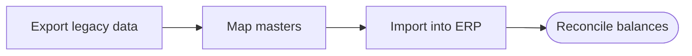

### 22.1 Overview of the Migration Flow

The data must be entered in the following order. Each step depends on the previous one being complete.

```
1. Company, Branch, GSTIN, Retail, Fiscal Year  (Setup Wizard)
       ↓
2. Account Groups + System Ledgers              (Setup Wizard: auto-seeded)
       ↓
3. States, TDS/TCS Sections, HSN Codes, Purities (Setup Wizard: auto-seeded)
       ↓
4. Item Masters & Packets                        (Masters section)
       ↓
5. Ledger Masters (Customers, Vendors, Banks,    (CRM → Ledgers)
   Karigars, etc.) with opening balances
       ↓
6. Opening Stock (Barcoded & Raw)               (Inventory section)
       ↓
7. Fixed Assets with opening WDV                (Fixed Assets section)
       ↓
8. Ledger Opening Balances (Trial Balance)       (Financial Accounting)
       ↓
9. Pending Orders & Job Cards (optional)         (Sales / Manufacturing)
```

### 22.2 Step-by-Step Instructions

#### Step 1 — Complete the Setup Wizard

Run the setup wizard at **Settings > Setup Wizard** if you have not already done so. This creates your company, branch, GSTIN, at least one retail location, and the active fiscal year. The wizard also auto-seeds:

- All Indian states/UTs
- Chart of accounts (account groups)
- TDS and TCS sections
- Default HSN codes for jewellery
- Default purity masters

Do not skip any wizard step before proceeding.

#### Step 2 — Create Item Masters

Before entering any stock, set up your item hierarchy:

1. Navigate to **Masters > Item Group** — create main categories (Gold Jewellery, Diamond Jewellery, Silver, etc.)
2. Navigate to **Masters > Item Master** — create individual items within each group
3. Navigate to **Masters > Packet Master** — define stone specification packets if you carry stones

Pull this data from your old ERP's item list or stock registers.

#### Step 3 — Create Ledger Masters

Create ledger accounts for every party you transact with. Navigate to **CRM > Ledgers > New Ledger** for each.

| Ledger Type | Role to Assign | Account Group |
|---|---|---|
| Customer | Customer (CO) | Sundry Debtors |
| Wholesale Dealer | Dealer (DL) | Sundry Debtors |
| Supplier / Vendor | Vendor (VD) | Sundry Creditors |
| Karigar | Karigar (KR) | Sundry Creditors |
| Bank Account | Bank Account (BA) | Bank Accounts |
| Cash Account | Cash (CA) | Cash-in-Hand |
| Expense accounts | — | Relevant expense group |

**Tips:**
- If a party is both a customer and a supplier, assign both roles (CO + VD) on the same ledger
- GST number, PAN, and state are required for B2B parties for correct tax treatment
- For banks, enter the account number and IFSC in the contact section
- For large ledger lists (100+ parties), use the **bulk CSV import** at **CRM > Ledger > Import** instead of manual entry — see Section 6.4 for details

#### Step 4 — Enter Opening Stock

##### Barcoded Stock

For each barcoded item in hand on your cut-over date:

1. Navigate to **Inventory > Barcode Management > Barcodes**
2. Click **Add New Barcode**
3. Enter all fields: barcode number, item, purity, gross weight, pcs, making type, making value, and packet details (for stone items)
4. Set **Status** to `In Stock`

If you have many barcodes, use the **Import** feature: navigate to **Masters > Import Data**, download the barcode import template, fill it from your old system's stock report, and upload.

##### Raw / Unbarcoded Stock

For raw material (gold bars, silver, loose stones) that is not barcoded:

1. Navigate to **Inventory > Raw Material Ledger**
2. Enter an opening balance entry for each material type and purity
3. Enter quantity (in grams), purity, and value

#### Step 5 — Enter Fixed Asset Opening Balances

For each fixed asset on your balance sheet on the cut-over date:

1. Navigate to **Financial Accounting > Fixed Assets > Asset Master**
2. Click **Add Asset**
3. Fill in the following fields:

| Field | What to Enter |
|---|---|
| Asset Code | Unique code (e.g., `COMP-001`, `VEH-001`) |
| Asset Name | Descriptive name (e.g., "Dell Laptop — Accounts") |
| Purchase Date | Original date of purchase (not the cut-over date) |
| Purchase Cost | Original cost at the time of purchase |
| Residual Value | Expected scrap value at end of life |
| Depreciation Method | WDV (Income Tax Act) or SLM (Companies Act) |
| IT Block Category | Select the applicable IT Act block |
| Rate or Useful Life | Depreciation % (WDV) or years (SLM) |

> **For migration specifically:** After saving the asset, the system will calculate accumulated depreciation from the purchase date to the cut-over date automatically when you run the Depreciation Worksheet. Review and approve this opening depreciation to establish the correct **Written Down Value (WDV)** as of the cut-over date. Do this before recording any new depreciation for the current year.

If you already know the WDV as of the cut-over date from your old ERP's fixed asset register:
- Cross-check it against the system's calculated WDV
- If there is a difference (rounding, block-pooling in old system), enter a one-time adjusting journal entry to the accumulated depreciation ledger

#### Step 6 — Enter Ledger Opening Balances

Enter the opening trial balance — the balances of all ledgers as of the cut-over date from your old ERP's trial balance report.

1. Navigate to **Financial Accounting > Vouchers > Journal**
2. Select voucher type **OPENING** (or the fiscal year's first date)
3. Enter each ledger with its Dr/Cr balance:
   - All customer balances as **Debit** (they owe you)
   - All supplier/karigar balances as **Credit** (you owe them)
   - Bank account balances as **Debit**
   - Cash balance as **Debit**
   - Loan/liability balances as **Credit**
   - Capital account as **Credit**
   - Fixed asset account totals as **Debit** (gross cost)
   - Accumulated depreciation as **Credit**
   - Retained earnings / P&L carried forward as **Credit**
4. The journal must balance (Total Debit = Total Credit) before saving

> **Important:** The fixed asset account in the journal represents the gross cost of all assets. The accumulated depreciation account represents all depreciation up to the cut-over date. The difference between the two equals the total WDV, which should match the sum of individual asset WDVs from Step 5.

#### Step 7 — Enter Pending Customer Orders (Optional)

If you have open customer orders that were taken in your old system and have not yet been delivered, enter them in **Sales > Customer Orders** so they flow correctly into manufacturing job cards and pending reports. Only enter orders that are still open (not yet fully delivered).

#### Step 8 — Enter Pending Karigar Job Cards (Optional)

If you have gold or stones currently issued to karigars and not yet received back, enter opening issue records in **Manufacturing > Issue > Job Work**. This ensures your karigar-wise outstanding reports are accurate from day one.

### 22.3 Verification Checklist

After completing migration, verify the following before going live:

- [ ] Trial balance Total Debit = Total Credit
- [ ] Bank ledger balances match bank statements on cut-over date
- [ ] Cash ledger balance matches physical cash count
- [ ] Total barcoded stock WGT matches your old system's stock report
- [ ] Total raw material balance matches your old system
- [ ] Fixed asset WDV total in ERP matches fixed asset register from old ERP
- [ ] Customer outstanding total matches old system's debtors report
- [ ] Vendor outstanding total matches old system's creditors report
- [ ] All GST input/output credit carry-forwards are entered if applicable

### 22.4 What NOT to Enter

Avoid entering the following historical data unless specifically required:

- Completed past vouchers (old invoices, old receipts) — only opening balances are needed
- Closed job cards and completed orders — only open/pending ones matter
- Historical depreciation voucher-by-voucher — enter opening accumulated depreciation as a single lump sum

---

## 23. AI Assistant & MCP Server Setup

Jewel India ERP includes a built-in AI assistant powered by **OpenAI** (GPT-4o). The AI can answer business questions in plain English, such as:

- "What were total sales last month?"
- "Show me outstanding dues from customers over ₹50,000"
- "Which karigar has the most gold pending return?"
- "What is the current gold stock valuation?"

There are two ways to use the AI:

1. **In-app AI Chat** — available directly in the ERP interface (no additional setup required)
2. **MCP Server** — connects the ERP's data to Claude Desktop or other AI clients on your computer for a richer, conversational experience

### 23.1 In-App AI Chat

No setup required. Navigate to the **AI Assistant** section in the sidebar. Type your question in plain English and press Enter. The assistant has read access to all your ERP data but cannot modify records.

> **Note:** The in-app AI is powered by **OpenAI** (GPT-4o-mini for queries, GPT-4o for invoice parsing). The MCP Server in Section 23.2 is what connects your ERP data to **Claude Desktop** (Anthropic). These are two separate integrations.

### 23.2 AI Invoice Parser

The invoice parser reads a scanned vendor bill (image or PDF) and extracts structured data automatically — saving manual data entry time when entering purchase vouchers.

**Supported file types:** JPG, PNG, WEBP, PDF (max 10 MB)

**How to use:**

1. Navigate to **AI Assistant > Invoice Parser**
2. Click **Upload Invoice** and select the vendor's bill file
3. The AI extracts:
   - Vendor name, bill number, bill date
   - Line items (description, quantity, rate, amount)
   - GST breakup (CGST, SGST, IGST)
   - Total amount, TDS if applicable
4. Review the extracted data for accuracy
5. Click **Create Purchase Voucher** to pre-fill the purchase entry form with the extracted data
6. Complete any missing fields and save the voucher

> The parser uses GPT-4o Vision. Always verify extracted values against the original document before saving — OCR can occasionally misread handwritten or low-resolution bills.

### 23.3 AI Account Suggestion

When creating journal, payment, or receipt vouchers, the system can suggest the correct debit and credit accounts based on a plain-English description.

**How to use:**

1. In any voucher entry form, click **Suggest Accounts**
2. Type a brief description of the transaction, e.g.:
   - "Paid BESCOM electricity bill ₹4,500"
   - "Received payment from Ravi Jewellers against invoice"
   - "Purchased gold from refinery"
3. The AI responds with:
   - Suggested **Debit Account**
   - Suggested **Credit Account**
   - Confidence score and reasoning
4. Accept the suggestion or override manually

### 23.4 AI Query History

All natural language queries made by your team are logged. To review:

1. Navigate to **AI Assistant > Query History**
2. Filter by user or date range
3. See each question asked, the response given, and tokens used

Admin users can see queries from all staff. Regular users see only their own history.

### 23.5 MCP Server Setup (Claude Desktop)

The MCP (Model Context Protocol) server exposes your ERP data as tools that Claude Desktop can call. This gives you a full conversational AI experience with your business data.

#### Prerequisites

- Claude Desktop installed on your computer ([download from claude.ai](https://claude.ai/download))
- The ERP backend must be running (`python manage.py runserver`)
- Python virtual environment must be active

#### Configuration

1. **Locate your Claude Desktop config file:**

   - **Windows:** `%APPDATA%\Claude\claude_desktop_config.json`
   - **macOS:** `~/Library/Application Support/Claude/claude_desktop_config.json`

2. **Open the config file** in any text editor. If it does not exist, create it.

3. **Add the MCP server entry:**

```json
{
  "mcpServers": {
    "jewel-india-erp": {
      "command": "python",
      "args": ["C:\\path\\to\\your\\Jewel India ERP\\backend\\mcp_server.py"],
      "env": {
        "DJANGO_SETTINGS_MODULE": "jewel_test.settings"
      }
    }
  }
}
```

Replace `C:\\path\\to\\your\\Jewel India ERP` with the actual path where you installed the ERP. Use double backslashes (`\\`) on Windows.

4. **Save the config file** and **restart Claude Desktop** completely (quit and reopen — not just close the window).

5. **Verify the connection:** Open Claude Desktop and look for the hammer icon (🔨) in the chat input area. Click it — you should see tools listed like `get_sales_summary`, `get_outstanding_debtors`, `get_stock_summary`, etc. If you see these, the connection is working.

#### Testing the Connection

In Claude Desktop, type:

> "Connect to Jewel India ERP and show me the available retail locations."

Claude will call the ERP and respond with your retail location list. If it works, you can ask any business question.

#### Available AI Tools

| Tool | What It Does |
|---|---|
| `get_sales_summary` | Total sales, invoice count, top customers for a date range |
| `get_outstanding_debtors` | All customers with unpaid balances |
| `get_outstanding_creditors` | All vendors/karigars with payable balances |
| `get_stock_summary` | Current barcoded stock count and weight by category |
| `get_stock_valuation` | Stock value breakdown by item and purity |
| `get_karigar_jobs_status` | Gold and stones currently with karigars |
| `get_ledger_balance` | Balance of any specific ledger account |
| `get_trial_balance_summary` | Summarised trial balance for a period |
| `get_cash_position` | Current cash and bank balances |
| `get_day_book` | All vouchers for a given date range |
| `get_profit_and_loss` | P&L statement for a period |
| `get_balance_sheet` | Balance sheet as of a date |
| `get_gst_summary` | GST output, input, and net payable |
| `get_scheme_summary` | Gold scheme enrollment and payment stats |
| `get_dashboard_summary` | Combined business health snapshot |

#### Multi-Location Usage

If you have multiple retail locations, you can specify a retail code in your question:

> "Show me outstanding debtors for the Borivali branch."

Claude will pass the appropriate `retail_code` to filter results for that location.

#### Troubleshooting the MCP Connection

| Problem | Solution |
|---|---|
| Tools not appearing in Claude Desktop | Restart Claude Desktop completely; verify the path in config is correct |
| "Django settings not found" error | Ensure `DJANGO_SETTINGS_MODULE` is set in the env block of the config |
| "Database locked" errors | Make sure only one Django process is running; close the dev server and restart |
| No data returned | Confirm the ERP backend is running on `http://127.0.0.1:8000` |
| Python not found | Use the full path to the venv Python: `C:\\...\\backend\\env\\Scripts\\python.exe` |

#### Using the Full Python Path (Recommended)

To avoid "Python not found" errors, use the full path to the virtual environment's Python executable instead of just `python`:

```json
{
  "mcpServers": {
    "jewel-india-erp": {
      "command": "C:\\path\\to\\Jewel India ERP\\backend\\env\\Scripts\\python.exe",
      "args": ["C:\\path\\to\\Jewel India ERP\\backend\\mcp_server.py"]
    }
  }
}
```

---

---

## 24. Performance & Scalability

This section explains how the ERP is tuned for speed and what you can do as load increases.

### 24.1 What Has Been Optimised

The following improvements are built into the codebase as of May 2026. No configuration is required for them to take effect.

#### Database Connection Reuse (`CONN_MAX_AGE`)

Previously, each HTTP request opened a new connection to the database and closed it when the response was sent. This added 5–10 ms of overhead on every API call. The connection is now **held open for 60 seconds** and reused across requests from the same worker process. This is controlled by the `DB_CONN_MAX_AGE` environment variable (default: 60).

#### SQLite Memory Tuning

The following SQLite settings are applied automatically when a connection is established:

| PRAGMA | Value | Effect |
|--------|-------|--------|
| `journal_mode` | `WAL` | Readers and writers no longer block each other. Multiple users can read simultaneously while one writes. |
| `synchronous` | `NORMAL` | Reduces disk flush frequency. Durable enough for normal use; improves write speed by ~30%. |
| `cache_size` | `-65536` (64 MB) | SQLite keeps 64 MB of database pages in memory per connection. Repeated reads of the same ledger, vouchers, or scheme data are served from memory. |
| `temp_store` | `MEMORY` | Sorting operations and temporary tables happen in RAM instead of writing to a temp file on disk. |
| `mmap_size` | `268435456` (256 MB) | The operating system memory-maps up to 256 MB of the database file. Sequential read-heavy reports (trial balance, P&L) benefit the most. |

#### Report Query Optimisation

Two report functions that previously loaded all records into Python and filtered them in a loop have been rewritten to push all filtering into SQL:

- **Overdue installments:** The system now computes `months_elapsed` directly in the database and returns only enrollments where payments are behind — one SQL query instead of an O(N) loop.
- **Upcoming payment dues:** The next-due date per enrollment is now computed in SQL using SQLite's date arithmetic. Only enrollments falling within the requested window (7 days or current month) are returned.

These changes mean the dashboard loads in roughly the same time whether you have 100 enrollments or 10,000.

#### View-Level Response Caching

The following API endpoints cache their responses for **60 seconds**:

| Endpoint | Cache Duration |
|----------|---------------|
| Scheme Dashboard (extended) | 60 seconds |
| Scheme Summary KPIs | 60 seconds |
| Overdue Installments | 60 seconds |

When a staff member loads the dashboard, the server calculates the data once. Every subsequent load within 60 seconds is served instantly from the cache without hitting the database. The cache is **automatically cleared** when any payment is recorded or any enrollment is saved — so real changes are always reflected within the next page load.

**Cache backend by environment:**

| Environment | Cache Backend | Notes |
|-------------|--------------|-------|
| Development | File-based cache (`.cache/` folder in backend) | Shared across all worker processes; survives server restarts |
| Production | Redis (set `CACHE_BACKEND=redis` and `REDIS_URL` in `.env`) | Fastest; shared across all server nodes in a multi-server setup |

---

### 24.2 Capacity Estimates

| Setup | Safe Concurrent Users | Notes |
|-------|----------------------|-------|
| **Current (SQLite + sync workers)** | ~10–20 light users | SQLite single-writer lock; each gunicorn worker handles 1 request at a time. Suitable for one shop or a small team. |
| **SQLite + gevent workers** | ~50 concurrent | Use `GUNICORN_WORKER_CLASS=gevent` in production. Each worker handles 50 green-thread connections. Still limited by SQLite's write lock. |
| **PostgreSQL + gevent workers** | 100–300 concurrent | PostgreSQL has row-level locking. Writers do not block each other. Suitable for multi-branch deployments. |
| **PostgreSQL + async (uvicorn)** | 500+ concurrent | Full async Django + PostgreSQL. Long-term production target. |

---

### 24.3 Running in Production (Gunicorn)

A `gunicorn.conf.py` file is included in the `backend/` folder. Start the production server with:

```bash
cd backend
gunicorn -c gunicorn.conf.py jewel_test.wsgi:application
```

**Key environment variables for tuning:**

| Variable | Default | Description |
|----------|---------|-------------|
| `WEB_CONCURRENCY` | `(2 × CPU cores) + 1` | Number of gunicorn worker processes |
| `GUNICORN_WORKER_CLASS` | `gevent` | `gevent` for 100 concurrent; `sync` for SQLite development |
| `GUNICORN_WORKER_CONNECTIONS` | `50` | Greenlets per gevent worker |
| `GUNICORN_TIMEOUT` | `120` | Seconds before a slow request is killed |
| `GUNICORN_PORT` | `8000` | Port to bind on |
| `GUNICORN_LOG_LEVEL` | `info` | `debug`, `info`, `warning`, `error` |

Workers are automatically restarted after 1,000 requests (with ±100 jitter) to prevent memory growth in long-running processes. The app is pre-loaded once before forking workers (`preload_app = True`), saving 50–100 MB of RAM through OS copy-on-write.

---

## 25. Migrating to PostgreSQL

SQLite is used during development because it requires no installation or configuration — the database is a single file (`backend/db.sqlite3`). For production deployments serving more than one or two users simultaneously, **PostgreSQL is strongly recommended**.

This section walks through the complete migration from SQLite to PostgreSQL without losing any data.

---

### 25.1 When to Migrate

Migrate to PostgreSQL when any of the following apply:

- More than **2–3 staff users** access the ERP at the same time.
- You experience **"database is locked"** errors during normal use.
- You are deploying to a **cloud server** (VPS, AWS EC2, DigitalOcean Droplet, etc.).
- You want to run **nightly automated backups** using standard database tooling (`pg_dump`).
- You plan to add **multiple branch locations** accessing the same server.

---

### 25.2 Prerequisites

Before starting, ensure the following are installed on your server:

1. **PostgreSQL 15 or 16** — [postgresql.org/download](https://www.postgresql.org/download/)
2. **psycopg2** (the Python PostgreSQL driver):
   ```bash
   cd backend
   env\Scripts\pip install psycopg2-binary
   ```
3. The ERP backend must be stopped before the migration begins.

---

### 25.3 Step 1 — Create the PostgreSQL Database and User

Open a PostgreSQL prompt (run as the `postgres` system user):

```bash
psql -U postgres
```

Run the following SQL commands:

```sql
CREATE DATABASE jewel_erp;
CREATE USER jewel_user WITH PASSWORD 'your_strong_password_here';
ALTER ROLE jewel_user SET client_encoding TO 'utf8';
ALTER ROLE jewel_user SET default_transaction_isolation TO 'read committed';
ALTER ROLE jewel_user SET timezone TO 'Asia/Kolkata';
GRANT ALL PRIVILEGES ON DATABASE jewel_erp TO jewel_user;
\q
```

> **Password:** Use a long random password (20+ characters). Store it securely — you will need it in the next step.

---

### 25.4 Step 2 — Update the `.env` File

Open `backend/.env` and update or add the following variables:

```env
# Replace the old SQLite block with these:
DB_ENGINE=django.db.backends.postgresql
DB_NAME=jewel_erp
DB_USER=jewel_user
DB_PASSWORD=your_strong_password_here
DB_HOST=localhost
DB_PORT=5432

# Connection reuse — with PostgreSQL + PgBouncer in transaction mode, set this to 0.
# With direct connections (no pooler), 60 is fine.
DB_CONN_MAX_AGE=60

# Switch cache to Redis once Redis is also installed:
CACHE_BACKEND=redis
REDIS_URL=redis://127.0.0.1:6379/1
```

---

### 25.5 Step 3 — Update `settings.py` to Read PostgreSQL Config

Open `backend/jewel_test/settings.py` and replace the `DATABASES` block with:

```python
DATABASES = {
    'default': {
        'ENGINE': config('DB_ENGINE', default='django.db.backends.sqlite3'),
        'NAME': config('DB_NAME', default=str(BASE_DIR / 'db.sqlite3')),
        'USER': config('DB_USER', default=''),
        'PASSWORD': config('DB_PASSWORD', default=''),
        'HOST': config('DB_HOST', default=''),
        'PORT': config('DB_PORT', default=''),
        'CONN_MAX_AGE': config('DB_CONN_MAX_AGE', default=60, cast=int),
        'OPTIONS': {
            # SQLite-specific pragma — safe to leave; ignored by PostgreSQL
            'timeout': 30,
        },
    }
}
```

> **Note:** The SQLite WAL signal (`_activate_sqlite_wal`) in settings.py checks `connection.vendor == 'sqlite'` before applying PRAGMAs, so it will silently skip when PostgreSQL is the backend. No change needed there.

---

### 25.6 Step 4 — Export Data from SQLite

Install `django-admin-export` or use the built-in management command approach. The safest method is Django's `dumpdata`:

```bash
cd backend
env\Scripts\python manage.py dumpdata \
  --natural-foreign \
  --natural-primary \
  --exclude auth.permission \
  --exclude contenttypes \
  --indent 2 \
  > full_data_export.json
```

This creates a `full_data_export.json` file containing all your data. **Keep this file** — it is your migration backup.

> **Check the file size:** A healthy export for a year of data is typically 5–50 MB. If it is 0 bytes or unusually small, something went wrong — investigate before continuing.

---

### 25.7 Step 5 — Apply Migrations to PostgreSQL

With the `.env` now pointing to PostgreSQL, run migrations to create all tables:

```bash
cd backend
env\Scripts\python manage.py migrate
```

You should see a long list of `OK` lines. If you see errors, the most common cause is a missing psycopg2 installation — re-run the `pip install psycopg2-binary` step.

---

### 25.8 Step 6 — Load the Data into PostgreSQL

```bash
cd backend
env\Scripts\python manage.py loaddata full_data_export.json
```

This will take 1–10 minutes depending on data volume. You should see output like:

```
Installed 48392 object(s) from 1 fixture(s)
```

> **If you see errors about duplicate keys or constraint violations:** This usually means `contenttypes` or `auth.permission` data was included. Re-run `dumpdata` with the `--exclude` flags shown in Step 4 and try again.

---

### 25.9 Step 7 — Fix PostgreSQL Sequence Numbers

PostgreSQL uses sequences (auto-increment counters) for primary keys. After importing data from SQLite, these sequences are not updated — the database doesn't know what the highest ID in each table is. If you try to save a new record, it will fail with a duplicate key error.

Fix all sequences in one command:

```bash
cd backend
env\Scripts\python manage.py shell -c "
from django.db import connection
with connection.cursor() as cursor:
    cursor.execute(\"\"\"
        SELECT 'SELECT SETVAL(' || quote_literal(quote_ident(s.relname)) || ', MAX(' || quote_ident(a.attname) || ')) FROM ' || quote_ident(c.relname) || ';'
        FROM pg_class c
        JOIN pg_attribute a ON a.attrelid = c.oid
        JOIN pg_attrdef d ON (d.adrelid = c.oid AND d.adnum = a.attnum)
        JOIN pg_class s ON s.oid = (pg_get_expr(d.adbin, d.adrelid) ~ 'nextval')::boolean::int = 1
            AND s.oid = (SELECT oid FROM pg_class WHERE relname = regexp_replace(pg_get_expr(d.adbin, d.adrelid), $$^nextval\('([^']+)'.*$$, '\1')::regclass)
        WHERE c.relkind = 'r' AND a.atthasdef AND pg_get_expr(d.adbin, d.adrelid) LIKE 'nextval%'
    \"\"\")
    statements = cursor.fetchall()
    for (stmt,) in statements:
        try:
            cursor.execute(stmt)
        except Exception as e:
            print(f'Skipped: {e}')
print('Sequences reset.')
"
```

Alternatively, use the `sqlsequencereset` management command per app:

```bash
env\Scripts\python manage.py sqlsequencereset \
  contacts userauth mastersconfig goldrates sales purchase \
  manufacturing inventory accounting goldscheme hr audit \
  | env\Scripts\python manage.py dbshell
```

---

### 25.10 Step 8 — Verify the Migration

Run the following checks:

**1. Check record counts match your SQLite export:**
```bash
env\Scripts\python manage.py shell -c "
from sales.models import SalesVou
from contacts.models import Ledger
from goldscheme.models import SchemeEnrollment
from accounting.models import VoucherMain
print('Sales vouchers:', SalesVou.objects.count())
print('Ledgers:', Ledger.objects.count())
print('Enrollments:', SchemeEnrollment.objects.count())
print('Vouchers:', VoucherMain.objects.count())
"
```

Compare these numbers against the same counts from your SQLite database (run the same script before switching).

**2. Start the server and log in:**
```bash
env\Scripts\python manage.py runserver
```

Navigate to the dashboard, open a sales voucher, check the ledger list, and verify the Gold Scheme dashboard loads correctly.

**3. Record one test transaction** (a payment, a small voucher entry, or anything that writes to the database) and confirm it saves without errors.

---

### 25.11 Step 9 — Update Gunicorn for PostgreSQL

Once on PostgreSQL, update your production startup to use the full async worker class for maximum throughput:

In `.env` or the server's environment:
```env
GUNICORN_WORKER_CLASS=uvicorn.workers.UvicornWorker
```

Install uvicorn if not already present:
```bash
env\Scripts\pip install uvicorn[standard]
```

This requires switching `WSGI_APPLICATION` to `ASGI_APPLICATION` in `settings.py` — a one-line change. Consult the technical team before doing this on a live server.

---

### 25.12 Optional — Install PgBouncer (Connection Pooling)

With PostgreSQL, each gunicorn worker still opens a direct database connection. Under high concurrency (100+ users), PostgreSQL can hit its `max_connections` limit. PgBouncer sits between Django and PostgreSQL, maintaining a small pool of real connections and routing thousands of Django requests through them.

**Install PgBouncer (Ubuntu/Debian):**
```bash
sudo apt install pgbouncer
```

**Basic `pgbouncer.ini` config:**
```ini
[databases]
jewel_erp = host=127.0.0.1 port=5432 dbname=jewel_erp

[pgbouncer]
listen_addr = 127.0.0.1
listen_port = 6432
auth_type = md5
pool_mode = transaction
max_client_conn = 500
default_pool_size = 20
```

**Then update `.env` to point Django at PgBouncer:**
```env
DB_HOST=127.0.0.1
DB_PORT=6432
DB_CONN_MAX_AGE=0   # Must be 0 in transaction-mode PgBouncer
```

> **Important:** Set `CONN_MAX_AGE=0` when using PgBouncer in transaction mode. PgBouncer manages the pooling itself; Django's own connection persistence interferes with it.

---

### 25.13 Rollback Plan

If the migration fails or produces incorrect data:

1. Stop the server.
2. Update `.env` to restore the SQLite config (`DB_ENGINE=django.db.backends.sqlite3`, remove PostgreSQL fields).
3. Restart the server — your original SQLite database is untouched.
4. Investigate the error using the `full_data_export.json` file.

The SQLite database file at `backend/db.sqlite3` is never modified during the PostgreSQL migration. It is safe to migrate while keeping it as a fallback.

---

## Document Information

| Field | Value |
|-------|-------|
| **Document Title** | Jewel India ERP - User Manual |
| **Version** | 1.4 — May 2026 update |
| **Date** | May 2026 |
| **Prepared For** | First-time ERP clients |
| **Confidentiality** | Client-use only |

---

*This manual covers the core features of Jewel India ERP. For API documentation, developer guides, or custom integrations, please contact the vendor's technical team.*
