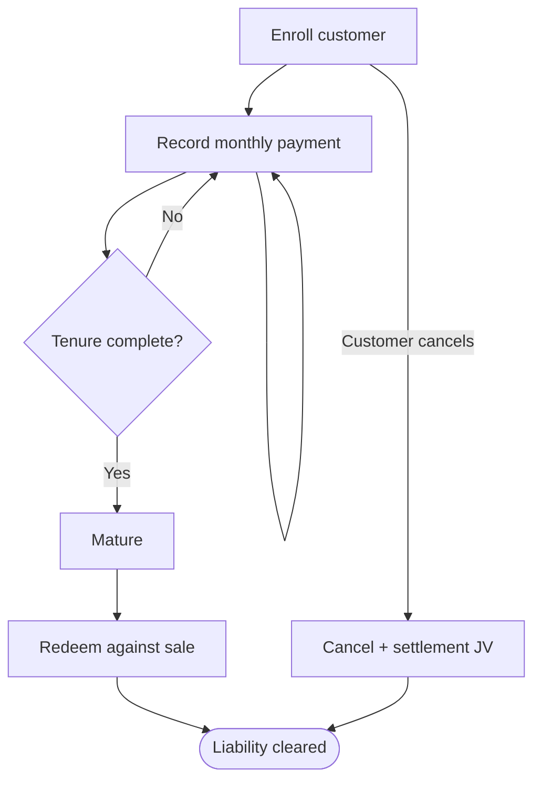
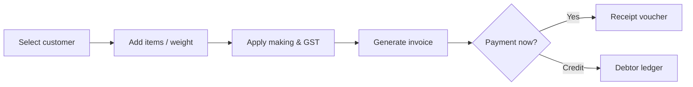
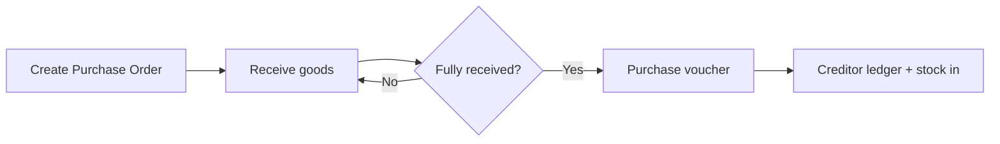

# In-App Help Center Implementation Plan

> **For agentic workers:** REQUIRED SUB-SKILL: Use superpowers:subagent-driven-development (recommended) or superpowers:executing-plans to implement this plan task-by-task. Steps use checkbox (`- [ ]`) syntax for tracking.

**Goal:** Integrate `docs/USER_MANUAL.md` into the React frontend as a searchable, navigable Help Center reachable from a global `?` button, with Mermaid workflow diagrams authored inline in the manual.

**Architecture:** The canonical manual is copied into the frontend at build time (`scripts/sync-manual.mjs`, wired to `predev`/`prebuild`) and imported via Vite `?raw`. A pure parser splits it into a chapter/section tree; fuse.js powers full-text search; `marked` + `DOMPurify` render sanitized HTML; `mermaid` (lazy-loaded) renders ```mermaid blocks to SVG. The `?` button opens a slide-over drawer (reusing the existing shadcn `Sheet`) for quick lookups, with an "Open full page →" link to a code-split `/help` route.

**Tech Stack:** React 18, Vite 5, react-router-dom 7, Tailwind, shadcn/ui (`Sheet`, `Button`, `Input`, `ScrollArea`), fuse.js (installed). New: `marked`, `dompurify`, `mermaid`, `@tailwindcss/typography`; dev: `vitest`, `jsdom`, `@testing-library/react`, `@testing-library/jest-dom`, `@testing-library/user-event`.

**Conventions:**
- All commands run from `D:\Jewel India ERP\frontend` unless noted.
- `@/` is the alias for `frontend/src`.
- TDD applies to pure logic (parser, slug, search). UI components get render smoke-tests in jsdom; Mermaid/visual rendering is verified manually (jsdom can't lay out SVG).

---

## File Structure

**Create:**
- `frontend/scripts/sync-manual.mjs` — copies the canonical manual into the frontend.
- `frontend/vitest.config.js` — vitest + jsdom config.
- `frontend/src/test/setup.js` — testing-library matchers.
- `frontend/src/help/manual.js` — `slugify`, `stripMarkdown`, `parseManual` (pure).
- `frontend/src/help/manual.test.js` — parser unit tests.
- `frontend/src/help/helpSearch.js` — `buildIndex`, `search`, `makeSnippet`.
- `frontend/src/help/helpSearch.test.js` — search unit tests.
- `frontend/src/help/markdown.js` — `renderMarkdown` (marked + DOMPurify).
- `frontend/src/help/useManual.js` — memoized manual provider (`getManual`, `useManual`).
- `frontend/src/help/MermaidDiagram.jsx` — lazy mermaid → SVG.
- `frontend/src/help/MarkdownView.jsx` — renders section HTML + mounts diagrams + highlight.
- `frontend/src/help/MarkdownView.test.jsx` — render smoke test.
- `frontend/src/help/HelpDrawer.jsx` — slide-over search + content.
- `frontend/src/help/HelpDrawer.test.jsx` — search→result smoke test.
- `frontend/src/help/HelpButton.jsx` — the `?` header button + drawer.
- `frontend/src/help/HelpCenter.jsx` — `/help` full page (TOC + content + search).
- `frontend/src/help/manual.generated.md` — generated, **gitignored**.

**Modify:**
- `frontend/package.json` — deps + scripts.
- `frontend/vite.config.js` — code-split help/mermaid chunks.
- `frontend/tailwind.config.js` — add typography plugin.
- `frontend/src/App.jsx` — register lazy `/help` route.
- `frontend/src/breadCrumbDecor.jsx` — mount `HelpButton`.
- `.gitignore` (repo root) — ignore `frontend/src/help/manual.generated.md`.
- `docs/USER_MANUAL.md` — add ```mermaid workflow diagrams (Phase 3).

---

## Phase 0 — Tooling & Sync

### Task 1: Install dependencies

- [ ] **Step 1: Install runtime + dev dependencies**

Run (from `frontend`):
```bash
npm install marked dompurify mermaid
npm install -D vitest jsdom @testing-library/react @testing-library/jest-dom @testing-library/user-event @tailwindcss/typography
```
Expected: `package.json` gains the deps; no peer-dependency errors that abort install.

- [ ] **Step 2: Commit**

```bash
git add package.json package-lock.json
git commit -m "chore(help): add markdown/mermaid/test deps for Help Center"
```

### Task 2: Manual sync script + npm hooks

**Files:**
- Create: `frontend/scripts/sync-manual.mjs`
- Modify: `frontend/package.json`
- Modify: `.gitignore`

- [ ] **Step 1: Write the sync script**

Create `frontend/scripts/sync-manual.mjs`:
```js
import { copyFileSync, mkdirSync, existsSync } from 'node:fs';
import { dirname, resolve } from 'node:path';
import { fileURLToPath } from 'node:url';

const here = dirname(fileURLToPath(import.meta.url));
const src = resolve(here, '../../docs/USER_MANUAL.md');
const destDir = resolve(here, '../src/help');
const dest = resolve(destDir, 'manual.generated.md');

if (!existsSync(src)) {
  console.error(`[sync-manual] source not found: ${src}`);
  process.exit(1);
}
mkdirSync(destDir, { recursive: true });
copyFileSync(src, dest);
console.log(`[sync-manual] copied ${src} -> ${dest}`);
```

- [ ] **Step 2: Add npm scripts**

In `frontend/package.json`, edit the `"scripts"` block to:
```json
"scripts": {
  "dev": "vite",
  "build": "vite build",
  "lint": "eslint .",
  "preview": "vite preview",
  "sync:manual": "node scripts/sync-manual.mjs",
  "predev": "node scripts/sync-manual.mjs",
  "prebuild": "node scripts/sync-manual.mjs",
  "test": "vitest run",
  "test:watch": "vitest",
  "test:e2e": "cypress open",
  "test:e2e:run": "cypress run"
}
```

- [ ] **Step 3: Gitignore the generated copy**

Append to the repo-root `.gitignore`:
```
frontend/src/help/manual.generated.md
```

- [ ] **Step 4: Run the sync and verify output**

Run (from `frontend`): `npm run sync:manual`
Expected: prints `[sync-manual] copied …USER_MANUAL.md -> …src/help/manual.generated.md`, and the file exists:
```bash
node -e "console.log(require('fs').existsSync('src/help/manual.generated.md'))"
```
Expected: `true`

- [ ] **Step 5: Commit**

```bash
git add frontend/scripts/sync-manual.mjs frontend/package.json .gitignore
git commit -m "feat(help): sync USER_MANUAL.md into frontend at build time"
```

### Task 3: Vitest config

**Files:**
- Create: `frontend/vitest.config.js`
- Create: `frontend/src/test/setup.js`

- [ ] **Step 1: Write vitest config**

Create `frontend/vitest.config.js`:
```js
import { defineConfig } from 'vitest/config';
import path from 'path';

export default defineConfig({
  resolve: { alias: { '@': path.resolve(__dirname, './src') } },
  test: {
    environment: 'jsdom',
    globals: true,
    setupFiles: ['./src/test/setup.js'],
    include: ['src/**/*.test.{js,jsx}'],
  },
});
```

- [ ] **Step 2: Write the test setup file**

Create `frontend/src/test/setup.js`:
```js
import '@testing-library/jest-dom';
```

- [ ] **Step 3: Add a trivial smoke test and verify the runner works**

Create `frontend/src/test/smoke.test.js`:
```js
import { describe, it, expect } from 'vitest';

describe('vitest', () => {
  it('runs', () => {
    expect(1 + 1).toBe(2);
  });
});
```
Run: `npm test`
Expected: 1 passed.

- [ ] **Step 4: Delete the smoke test and commit config**

```bash
rm src/test/smoke.test.js
git add frontend/vitest.config.js frontend/src/test/setup.js
git commit -m "chore(help): configure vitest + jsdom"
```

---

## Phase 1 — Manual Parser, Search, Rendering (TDD)

### Task 4: `slugify` (TDD)

**Files:**
- Create: `frontend/src/help/manual.js`
- Test: `frontend/src/help/manual.test.js`

- [ ] **Step 1: Write the failing test**

Create `frontend/src/help/manual.test.js`:
```js
import { describe, it, expect } from 'vitest';
import { slugify } from './manual';

describe('slugify', () => {
  it('turns a chapter heading into a numeric slug', () => {
    expect(slugify('14. Gold Scheme Management')).toBe('14-gold-scheme-management');
  });
  it('turns a sub-section heading into a dotted-number slug', () => {
    expect(slugify('14.3 Recording a Payment')).toBe('14-3-recording-a-payment');
  });
  it('drops punctuation and lowercases', () => {
    expect(slugify('GST & Tax Compliance')).toBe('gst-tax-compliance');
  });
  it('handles headings with no number', () => {
    expect(slugify('Best Practices')).toBe('best-practices');
  });
});
```

- [ ] **Step 2: Run test to verify it fails**

Run: `npx vitest run src/help/manual.test.js`
Expected: FAIL — `slugify` is not exported / file missing.

- [ ] **Step 3: Implement `slugify`**

Create `frontend/src/help/manual.js`:
```js
export function slugify(heading) {
  return String(heading)
    .trim()
    .toLowerCase()
    .replace(/[^\w\s.-]/g, '') // keep word chars, whitespace, dot, dash
    .replace(/\./g, '-')       // 14.3 -> 14-3
    .replace(/\s+/g, '-')      // spaces -> dash
    .replace(/-+/g, '-')       // collapse repeats
    .replace(/^-+|-+$/g, '');  // trim leading/trailing dashes
}
```

- [ ] **Step 4: Run test to verify it passes**

Run: `npx vitest run src/help/manual.test.js`
Expected: PASS (4 tests).

- [ ] **Step 5: Commit**

```bash
git add frontend/src/help/manual.js frontend/src/help/manual.test.js
git commit -m "feat(help): slugify headings into stable section ids"
```

### Task 5: `stripMarkdown` (TDD)

**Files:**
- Modify: `frontend/src/help/manual.js`
- Modify: `frontend/src/help/manual.test.js`

- [ ] **Step 1: Add failing tests**

Append to `frontend/src/help/manual.test.js`:
```js
import { stripMarkdown } from './manual';

describe('stripMarkdown', () => {
  it('removes fenced code blocks entirely', () => {
    const md = 'Intro text\n```mermaid\ngraph TD; A-->B\n```\nOutro text';
    const out = stripMarkdown(md);
    expect(out).toContain('Intro text');
    expect(out).toContain('Outro text');
    expect(out).not.toContain('graph TD');
  });
  it('strips heading hashes and emphasis', () => {
    expect(stripMarkdown('## 7. Sales Module')).toBe('7. Sales Module');
    expect(stripMarkdown('Use **bold** and *italic*')).toBe('Use bold and italic');
  });
});
```

- [ ] **Step 2: Run test to verify it fails**

Run: `npx vitest run src/help/manual.test.js`
Expected: FAIL — `stripMarkdown` not exported.

- [ ] **Step 3: Implement `stripMarkdown`**

Append to `frontend/src/help/manual.js`:
```js
export function stripMarkdown(md) {
  return String(md)
    .replace(/```[\s\S]*?```/g, ' ')  // drop fenced code (incl. mermaid)
    .replace(/`([^`]+)`/g, '$1')      // inline code
    .replace(/^#{1,6}\s+/gm, '')      // heading hashes
    .replace(/\*\*([^*]+)\*\*/g, '$1')// bold
    .replace(/\*([^*]+)\*/g, '$1')    // italic
    .replace(/!\[[^\]]*\]\([^)]*\)/g, '') // images
    .replace(/\[([^\]]+)\]\([^)]*\)/g, '$1') // links -> text
    .replace(/^\s*[-*+]\s+/gm, '')    // list bullets
    .replace(/\|/g, ' ')              // table pipes
    .replace(/[ \t]+/g, ' ')
    .trim();
}
```

- [ ] **Step 4: Run test to verify it passes**

Run: `npx vitest run src/help/manual.test.js`
Expected: PASS.

- [ ] **Step 5: Commit**

```bash
git add frontend/src/help/manual.js frontend/src/help/manual.test.js
git commit -m "feat(help): stripMarkdown for search indexing and snippets"
```

### Task 6: `parseManual` (TDD)

**Files:**
- Modify: `frontend/src/help/manual.js`
- Modify: `frontend/src/help/manual.test.js`

- [ ] **Step 1: Add failing tests**

Append to `frontend/src/help/manual.test.js`:
```js
import { parseManual } from './manual';

const SAMPLE = [
  '# Jewel India ERP - User Manual',
  '',
  '## 7. Sales Module',
  'Sales intro paragraph.',
  '',
  '### 7.1 Create an Invoice',
  'Steps to create an invoice.',
  '```bash',
  '## not a heading inside fence',
  '```',
  '',
  '## 14. Gold Scheme Management',
  'Scheme intro.',
  '',
  '### 14.3 Recording a Payment',
  'How to record a payment.',
].join('\n');

describe('parseManual', () => {
  it('splits into chapters and sections', () => {
    const { sections } = parseManual(SAMPLE);
    const ids = sections.map((s) => s.id);
    expect(ids).toEqual([
      '7-sales-module',
      '7-1-create-an-invoice',
      '14-gold-scheme-management',
      '14-3-recording-a-payment',
    ]);
  });
  it('ignores ## lines inside code fences', () => {
    const { sections } = parseManual(SAMPLE);
    expect(sections.find((s) => s.title.includes('not a heading'))).toBeUndefined();
  });
  it('links sections to their parent chapter', () => {
    const { sections } = parseManual(SAMPLE);
    const pay = sections.find((s) => s.id === '14-3-recording-a-payment');
    expect(pay.level).toBe('section');
    expect(pay.chapterId).toBe('14-gold-scheme-management');
  });
  it('captures markdown body and plainText for each section', () => {
    const { sections } = parseManual(SAMPLE);
    const sales = sections.find((s) => s.id === '7-sales-module');
    expect(sales.markdown).toContain('Sales intro paragraph.');
    expect(sales.plainText).toContain('Sales intro paragraph.');
  });
  it('builds a nested toc of chapters with section children', () => {
    const { toc } = parseManual(SAMPLE);
    expect(toc.map((c) => c.id)).toEqual(['7-sales-module', '14-gold-scheme-management']);
    expect(toc[1].children.map((s) => s.id)).toEqual(['14-3-recording-a-payment']);
  });
});
```

- [ ] **Step 2: Run test to verify it fails**

Run: `npx vitest run src/help/manual.test.js`
Expected: FAIL — `parseManual` not exported.

- [ ] **Step 3: Implement `parseManual`**

Append to `frontend/src/help/manual.js`:
```js
export function parseManual(raw) {
  const lines = String(raw).split('\n');
  const sections = [];
  let inFence = false;
  let lastChapterId = null;
  let current = null;
  const bodyLines = [];

  const flush = () => {
    if (current) {
      current.markdown = bodyLines.join('\n').trim();
      current.plainText = stripMarkdown(current.markdown);
      sections.push(current);
    }
    bodyLines.length = 0;
  };

  for (const line of lines) {
    if (/^```/.test(line)) inFence = !inFence;
    const h = !inFence && line.match(/^(#{2,3})\s+(.*\S)\s*$/);
    if (h) {
      flush();
      const level = h[1].length === 2 ? 'chapter' : 'section';
      const title = h[2].trim();
      const id = slugify(title);
      if (level === 'chapter') lastChapterId = id;
      current = {
        id,
        title,
        level,
        chapterId: level === 'chapter' ? id : lastChapterId,
        markdown: '',
        plainText: '',
      };
    } else if (current) {
      bodyLines.push(line);
    }
  }
  flush();

  const toc = [];
  for (const s of sections) {
    if (s.level === 'chapter') {
      toc.push({ id: s.id, title: s.title, children: [] });
    } else {
      const parent = toc[toc.length - 1];
      if (parent) parent.children.push({ id: s.id, title: s.title });
    }
  }
  return { sections, toc };
}
```

- [ ] **Step 4: Run test to verify it passes**

Run: `npx vitest run src/help/manual.test.js`
Expected: PASS (all parser tests).

- [ ] **Step 5: Commit**

```bash
git add frontend/src/help/manual.js frontend/src/help/manual.test.js
git commit -m "feat(help): parse USER_MANUAL.md into chapter/section tree"
```

### Task 7: Search index + snippet (TDD)

**Files:**
- Create: `frontend/src/help/helpSearch.js`
- Test: `frontend/src/help/helpSearch.test.js`

- [ ] **Step 1: Write the failing test**

Create `frontend/src/help/helpSearch.test.js`:
```js
import { describe, it, expect } from 'vitest';
import { buildIndex, search } from './helpSearch';

const SECTIONS = [
  { id: '14-3-recording-a-payment', title: 'Recording a Payment', chapterId: '14-gold-scheme-management',
    plainText: 'To record a gold scheme installment payment, open the enrollment and click Pay.' },
  { id: '10-2-barcode-split', title: 'Barcode Split', chapterId: '10-inventory',
    plainText: 'Split a barcoded lot into multiple pieces, each with its own weight.' },
  { id: '13-1-depreciation', title: 'Depreciation', chapterId: '13-fixed-assets',
    plainText: 'Fixed assets depreciate using the WDV or SLM method each fiscal year.' },
];

describe('help search', () => {
  it('finds a section by a natural phrase in the body', () => {
    const fuse = buildIndex(SECTIONS);
    const results = search(fuse, 'record scheme payment');
    expect(results[0].section.id).toBe('14-3-recording-a-payment');
  });
  it('matches on title', () => {
    const fuse = buildIndex(SECTIONS);
    const results = search(fuse, 'barcode split');
    expect(results[0].section.id).toBe('10-2-barcode-split');
  });
  it('returns a snippet containing a query term', () => {
    const fuse = buildIndex(SECTIONS);
    const results = search(fuse, 'depreciation');
    expect(results[0].snippet.toLowerCase()).toContain('depreciat');
  });
  it('returns nothing for blank/too-short queries', () => {
    const fuse = buildIndex(SECTIONS);
    expect(search(fuse, '')).toEqual([]);
    expect(search(fuse, 'a')).toEqual([]);
  });
});
```

- [ ] **Step 2: Run test to verify it fails**

Run: `npx vitest run src/help/helpSearch.test.js`
Expected: FAIL — module missing.

- [ ] **Step 3: Implement search**

Create `frontend/src/help/helpSearch.js`:
```js
import Fuse from 'fuse.js';

export function buildIndex(sections) {
  return new Fuse(sections, {
    keys: [
      { name: 'title', weight: 2 },
      { name: 'plainText', weight: 1 },
    ],
    includeScore: true,
    threshold: 0.4,
    ignoreLocation: true,
    minMatchCharLength: 2,
  });
}

export function makeSnippet(plainText, query, radius = 60) {
  const text = plainText || '';
  const terms = query.toLowerCase().split(/\s+/).filter(Boolean);
  let idx = -1;
  for (const t of terms) {
    idx = text.toLowerCase().indexOf(t);
    if (idx !== -1) break;
  }
  if (idx === -1) return text.slice(0, radius * 2).trim();
  const start = Math.max(0, idx - radius);
  const end = Math.min(text.length, idx + radius);
  return (start > 0 ? '… ' : '') + text.slice(start, end).trim() + (end < text.length ? ' …' : '');
}

export function search(fuse, query) {
  const q = (query || '').trim();
  if (q.length < 2) return [];
  return fuse.search(q).slice(0, 20).map((r) => ({
    section: r.item,
    score: r.score,
    snippet: makeSnippet(r.item.plainText, q),
  }));
}
```

- [ ] **Step 4: Run test to verify it passes**

Run: `npx vitest run src/help/helpSearch.test.js`
Expected: PASS (4 tests).

- [ ] **Step 5: Commit**

```bash
git add frontend/src/help/helpSearch.js frontend/src/help/helpSearch.test.js
git commit -m "feat(help): fuse.js full-text search with snippets"
```

### Task 8: Markdown renderer

**Files:**
- Create: `frontend/src/help/markdown.js`

- [ ] **Step 1: Implement the renderer**

Create `frontend/src/help/markdown.js`:
```js
import { marked } from 'marked';
import DOMPurify from 'dompurify';

marked.setOptions({ gfm: true, breaks: false });

// Allow rendered Mermaid SVG to survive sanitization.
const SVG_TAGS = ['svg', 'path', 'g', 'rect', 'circle', 'ellipse', 'line', 'polyline',
  'polygon', 'text', 'tspan', 'marker', 'defs', 'foreignobject', 'style'];
const SVG_ATTR = ['viewbox', 'd', 'points', 'transform', 'marker-end', 'marker-start',
  'orient', 'refx', 'refy', 'markerwidth', 'markerheight', 'x', 'y', 'x1', 'x2', 'y1', 'y2',
  'cx', 'cy', 'r', 'rx', 'ry', 'fill', 'stroke', 'stroke-width', 'text-anchor', 'font-size',
  'font-family', 'class', 'id', 'width', 'height', 'style', 'dominant-baseline'];

export function renderMarkdown(md) {
  const html = marked.parse(String(md || ''));
  return DOMPurify.sanitize(html, {
    ADD_TAGS: SVG_TAGS,
    ADD_ATTR: SVG_ATTR,
  });
}
```

- [ ] **Step 2: Verify it imports and renders (quick sanity test)**

Create `frontend/src/help/markdown.test.js`:
```js
import { describe, it, expect } from 'vitest';
import { renderMarkdown } from './markdown';

describe('renderMarkdown', () => {
  it('renders headings and tables to HTML', () => {
    const html = renderMarkdown('## Title\n\n| A | B |\n|---|---|\n| 1 | 2 |');
    expect(html).toContain('<h2');
    expect(html).toContain('<table');
  });
  it('strips script tags', () => {
    const html = renderMarkdown('ok <script>alert(1)</script>');
    expect(html).not.toContain('<script');
  });
  it('keeps mermaid code blocks as code elements', () => {
    const html = renderMarkdown('```mermaid\ngraph TD; A-->B\n```');
    expect(html).toContain('language-mermaid');
  });
});
```
Run: `npx vitest run src/help/markdown.test.js`
Expected: PASS (3 tests).

- [ ] **Step 3: Commit**

```bash
git add frontend/src/help/markdown.js frontend/src/help/markdown.test.js
git commit -m "feat(help): sanitized markdown rendering (marked + DOMPurify)"
```

### Task 9: Manual provider hook

**Files:**
- Create: `frontend/src/help/useManual.js`

- [ ] **Step 1: Implement the memoized provider**

Create `frontend/src/help/useManual.js`:
```js
import rawManual from './manual.generated.md?raw';
import { parseManual } from './manual';
import { buildIndex, search as runSearch } from './helpSearch';

let _cache = null;

export function getManual() {
  if (!_cache) {
    const { sections, toc } = parseManual(rawManual);
    _cache = {
      sections,
      toc,
      byId: Object.fromEntries(sections.map((s) => [s.id, s])),
      fuse: buildIndex(sections),
    };
  }
  return _cache;
}

export function useManual() {
  const m = getManual();
  return {
    toc: m.toc,
    sections: m.sections,
    getSection: (id) => m.byId[id] || null,
    search: (query) => runSearch(m.fuse, query),
  };
}
```

> Note: this module imports `manual.generated.md`, so it is only used by UI code (never by unit tests). `npm run sync:manual` must have been run (Task 2) for this to resolve.

- [ ] **Step 2: Verify the dev build resolves the ?raw import**

Run (from `frontend`): `npm run sync:manual && npm run build`
Expected: build succeeds (the `?raw` import resolves; no "failed to resolve" error).

- [ ] **Step 3: Commit**

```bash
git add frontend/src/help/useManual.js
git commit -m "feat(help): memoized manual provider with search"
```

---

## Phase 2 — UI

### Task 10: MermaidDiagram (lazy)

**Files:**
- Create: `frontend/src/help/MermaidDiagram.jsx`

- [ ] **Step 1: Implement the component**

Create `frontend/src/help/MermaidDiagram.jsx`:
```jsx
import { useEffect, useRef, useState } from 'react';

let _mermaidPromise = null;
function loadMermaid() {
  if (!_mermaidPromise) {
    _mermaidPromise = import('mermaid').then((m) => {
      m.default.initialize({ startOnLoad: false, securityLevel: 'strict', theme: 'neutral' });
      return m.default;
    });
  }
  return _mermaidPromise;
}

export default function MermaidDiagram({ code, id }) {
  const ref = useRef(null);
  const [error, setError] = useState(false);

  useEffect(() => {
    let cancelled = false;
    loadMermaid()
      .then((mermaid) => mermaid.render(`mmd-${id}-${Math.abs(hash(code))}`, code))
      .then(({ svg }) => {
        if (!cancelled && ref.current) ref.current.innerHTML = svg;
      })
      .catch(() => !cancelled && setError(true));
    return () => { cancelled = true; };
  }, [code, id]);

  if (error) {
    return (
      <details className="my-3 rounded border border-amber-300 bg-amber-50 p-2 text-sm">
        <summary>Diagram could not be rendered — show source</summary>
        <pre className="overflow-x-auto text-xs">{code}</pre>
      </details>
    );
  }
  return <div className="mermaid-diagram my-4 flex justify-center" ref={ref} aria-label="workflow diagram" />;
}

function hash(str) {
  let h = 0;
  for (let i = 0; i < str.length; i++) h = (h << 5) - h + str.charCodeAt(i) | 0;
  return h;
}
```

- [ ] **Step 2: Commit**

```bash
git add frontend/src/help/MermaidDiagram.jsx
git commit -m "feat(help): lazy-loaded Mermaid diagram renderer"
```

### Task 11: MarkdownView (renders HTML, mounts diagrams, highlights)

**Files:**
- Create: `frontend/src/help/MarkdownView.jsx`
- Test: `frontend/src/help/MarkdownView.test.jsx`

- [ ] **Step 1: Write the failing render test**

Create `frontend/src/help/MarkdownView.test.jsx`:
```jsx
import { describe, it, expect, vi } from 'vitest';
import { render, screen } from '@testing-library/react';
import MarkdownView from './MarkdownView';

vi.mock('./MermaidDiagram', () => ({ default: () => <div data-testid="mermaid" /> }));

describe('MarkdownView', () => {
  it('renders markdown headings and paragraphs', () => {
    render(<MarkdownView markdown={'## Sales\n\nCreate an invoice here.'} />);
    expect(screen.getByText('Create an invoice here.')).toBeInTheDocument();
  });
  it('mounts a MermaidDiagram for a mermaid code block', () => {
    render(<MarkdownView markdown={'```mermaid\ngraph TD; A-->B\n```'} />);
    expect(screen.getByTestId('mermaid')).toBeInTheDocument();
  });
  it('highlights matched terms', () => {
    const { container } = render(
      <MarkdownView markdown={'Record a payment now.'} highlightTerms={['payment']} />
    );
    expect(container.querySelector('mark')).not.toBeNull();
  });
});
```

- [ ] **Step 2: Run test to verify it fails**

Run: `npx vitest run src/help/MarkdownView.test.jsx`
Expected: FAIL — component missing.

- [ ] **Step 3: Implement MarkdownView**

Create `frontend/src/help/MarkdownView.jsx`:
```jsx
import { useMemo } from 'react';
import { renderMarkdown } from './markdown';
import MermaidDiagram from './MermaidDiagram';

// Split rendered HTML around mermaid code blocks so we can mount React diagrams.
const MERMAID_RE = /<pre><code class="language-mermaid">([\s\S]*?)<\/code><\/pre>/g;

function decode(html) {
  return html
    .replace(/&lt;/g, '<').replace(/&gt;/g, '>')
    .replace(/&quot;/g, '"').replace(/&#39;/g, "'").replace(/&amp;/g, '&');
}

function highlight(html, terms) {
  if (!terms || terms.length === 0) return html;
  const escaped = terms.filter(Boolean).map((t) => t.replace(/[.*+?^${}()|[\]\\]/g, '\\$&'));
  if (escaped.length === 0) return html;
  const re = new RegExp(`(${escaped.join('|')})`, 'gi');
  // Only highlight inside text nodes: split on tags, transform non-tag chunks.
  return html.replace(/(<[^>]+>)|([^<]+)/g, (m, tag, text) =>
    tag ? tag : text.replace(re, '<mark>$1</mark>')
  );
}

export default function MarkdownView({ markdown, highlightTerms, idPrefix = 'doc' }) {
  const parts = useMemo(() => {
    const html = renderMarkdown(markdown);
    const out = [];
    let last = 0;
    let i = 0;
    let match;
    MERMAID_RE.lastIndex = 0;
    while ((match = MERMAID_RE.exec(html)) !== null) {
      const before = html.slice(last, match.index);
      if (before) out.push({ type: 'html', html: highlight(before, highlightTerms) });
      out.push({ type: 'mermaid', code: decode(match[1]).trim(), key: `${idPrefix}-${i++}` });
      last = MERMAID_RE.lastIndex;
    }
    const tail = html.slice(last);
    if (tail) out.push({ type: 'html', html: highlight(tail, highlightTerms) });
    return out;
  }, [markdown, highlightTerms, idPrefix]);

  return (
    <div className="manual-prose prose prose-sm max-w-none dark:prose-invert">
      {parts.map((p, idx) =>
        p.type === 'mermaid' ? (
          <MermaidDiagram key={p.key} id={p.key} code={p.code} />
        ) : (
          <div key={idx} dangerouslySetInnerHTML={{ __html: p.html }} />
        )
      )}
    </div>
  );
}
```

- [ ] **Step 4: Run test to verify it passes**

Run: `npx vitest run src/help/MarkdownView.test.jsx`
Expected: PASS (3 tests).

- [ ] **Step 5: Commit**

```bash
git add frontend/src/help/MarkdownView.jsx frontend/src/help/MarkdownView.test.jsx
git commit -m "feat(help): MarkdownView with diagram mounting and term highlight"
```

### Task 12: Enable Tailwind typography

**Files:**
- Modify: `frontend/tailwind.config.js`

- [ ] **Step 1: Add the plugin**

In `frontend/tailwind.config.js`, change the plugins line:
```js
plugins: [require("tailwindcss-animate"), require("@tailwindcss/typography")],
```

- [ ] **Step 2: Verify build still succeeds**

Run: `npm run build`
Expected: build completes without "Cannot find module '@tailwindcss/typography'".

- [ ] **Step 3: Commit**

```bash
git add frontend/tailwind.config.js
git commit -m "chore(help): enable @tailwindcss/typography for manual prose"
```

### Task 13: HelpDrawer (slide-over search)

**Files:**
- Create: `frontend/src/help/HelpDrawer.jsx`
- Test: `frontend/src/help/HelpDrawer.test.jsx`

- [ ] **Step 1: Write the failing test**

Create `frontend/src/help/HelpDrawer.test.jsx`:
```jsx
import { describe, it, expect, vi } from 'vitest';
import { render, screen } from '@testing-library/react';
import userEvent from '@testing-library/user-event';
import { MemoryRouter } from 'react-router-dom';
import HelpDrawer from './HelpDrawer';

vi.mock('./useManual', () => ({
  useManual: () => ({
    getSection: (id) => ({ id, title: 'Recording a Payment', markdown: 'Open the enrollment and click Pay.' }),
    search: (q) =>
      q.includes('pay')
        ? [{ section: { id: '14-3', title: 'Recording a Payment', chapterId: '14-gold' }, snippet: 'click Pay to record a payment' }]
        : [],
  }),
}));
vi.mock('./MarkdownView', () => ({ default: ({ markdown }) => <div>{markdown}</div> }));

describe('HelpDrawer', () => {
  it('shows search results as the user types', async () => {
    const user = userEvent.setup();
    render(
      <MemoryRouter>
        <HelpDrawer open onOpenChange={() => {}} />
      </MemoryRouter>
    );
    await user.type(screen.getByPlaceholderText(/search the manual/i), 'pay');
    expect(await screen.findByText('Recording a Payment')).toBeInTheDocument();
  });
});
```

- [ ] **Step 2: Run test to verify it fails**

Run: `npx vitest run src/help/HelpDrawer.test.jsx`
Expected: FAIL — component missing.

- [ ] **Step 3: Implement HelpDrawer**

Create `frontend/src/help/HelpDrawer.jsx`:
```jsx
import { useState } from 'react';
import { useNavigate } from 'react-router-dom';
import { Search, ArrowLeft, ExternalLink } from 'lucide-react';
import {
  Sheet, SheetContent, SheetHeader, SheetTitle,
} from '@/components/ui/sheet';
import { Input } from '@/components/ui/input';
import { Button } from '@/components/ui/button';
import { ScrollArea } from '@/components/ui/scroll-area';
import { useManual } from './useManual';
import MarkdownView from './MarkdownView';

export default function HelpDrawer({ open, onOpenChange }) {
  const { search, getSection } = useManual();
  const navigate = useNavigate();
  const [query, setQuery] = useState('');
  const [activeId, setActiveId] = useState(null);

  const results = query.trim().length >= 2 ? search(query) : [];
  const active = activeId ? getSection(activeId) : null;
  const terms = query.trim().split(/\s+/).filter(Boolean);

  const openFullPage = (id) => {
    onOpenChange(false);
    navigate(`/help?q=${encodeURIComponent(query)}#${id}`);
  };

  return (
    <Sheet open={open} onOpenChange={onOpenChange}>
      <SheetContent side="right" className="flex w-full flex-col gap-3 sm:max-w-md">
        <SheetHeader>
          <SheetTitle>{active ? active.title : 'Help & Manual'}</SheetTitle>
        </SheetHeader>

        {!active && (
          <div className="relative">
            <Search className="absolute left-2 top-2.5 size-4 text-muted-foreground" />
            <Input
              autoFocus
              className="pl-8"
              placeholder="Search the manual…"
              value={query}
              onChange={(e) => setQuery(e.target.value)}
            />
          </div>
        )}

        <ScrollArea className="flex-1 pr-3">
          {active ? (
            <div className="space-y-3">
              <Button variant="ghost" size="sm" onClick={() => setActiveId(null)}>
                <ArrowLeft className="mr-1 size-4" /> Back to results
              </Button>
              <MarkdownView markdown={active.markdown} highlightTerms={terms} idPrefix={`drawer-${active.id}`} />
              <Button variant="outline" size="sm" className="w-full" onClick={() => openFullPage(active.id)}>
                <ExternalLink className="mr-1 size-4" /> Open full page
              </Button>
            </div>
          ) : (
            <ul className="space-y-1">
              {results.map((r) => (
                <li key={r.section.id}>
                  <button
                    className="w-full rounded p-2 text-left hover:bg-accent"
                    onClick={() => setActiveId(r.section.id)}
                  >
                    <div className="text-sm font-medium">{r.section.title}</div>
                    <div className="line-clamp-2 text-xs text-muted-foreground">{r.snippet}</div>
                  </button>
                </li>
              ))}
              {query.trim().length >= 2 && results.length === 0 && (
                <li className="p-2 text-sm text-muted-foreground">No results for “{query}”.</li>
              )}
            </ul>
          )}
        </ScrollArea>
      </SheetContent>
    </Sheet>
  );
}
```

- [ ] **Step 4: Run test to verify it passes**

Run: `npx vitest run src/help/HelpDrawer.test.jsx`
Expected: PASS.

- [ ] **Step 5: Commit**

```bash
git add frontend/src/help/HelpDrawer.jsx frontend/src/help/HelpDrawer.test.jsx
git commit -m "feat(help): slide-over Help drawer with search and full-page link"
```

### Task 14: HelpButton in the header

**Files:**
- Create: `frontend/src/help/HelpButton.jsx`
- Modify: `frontend/src/breadCrumbDecor.jsx`

- [ ] **Step 1: Implement HelpButton**

Create `frontend/src/help/HelpButton.jsx`:
```jsx
import { useState } from 'react';
import { HelpCircle } from 'lucide-react';
import { Button } from '@/components/ui/button';
import HelpDrawer from './HelpDrawer';

export default function HelpButton() {
  const [open, setOpen] = useState(false);
  return (
    <>
      <Button
        variant="ghost"
        size="icon"
        aria-label="Help & Manual"
        title="Help & Manual"
        onClick={() => setOpen(true)}
      >
        <HelpCircle className="size-5" />
      </Button>
      <HelpDrawer open={open} onOpenChange={setOpen} />
    </>
  );
}
```

- [ ] **Step 2: Mount it in the header**

In `frontend/src/breadCrumbDecor.jsx`:
1. Add the import near the other imports at the top:
```jsx
import HelpButton from "@/help/HelpButton";
```
2. Find where `RetailSelection` is rendered in the header's JSX (the right-hand controls area). Render `<HelpButton />` immediately before `<RetailSelection ... />` so the `?` sits to the left of the retail picker. Example shape:
```jsx
<div className="flex items-center gap-2">
  <HelpButton />
  <RetailSelection /* existing props unchanged */ />
</div>
```
If `RetailSelection` is not already wrapped in a flex container, wrap both as shown.

- [ ] **Step 3: Verify the app builds and the button appears**

Run: `npm run build`
Expected: build succeeds.
Then run `npm run dev`, open the app, confirm a `?` icon appears in the header and clicking it opens the drawer. (Manual visual check.)

- [ ] **Step 4: Commit**

```bash
git add frontend/src/help/HelpButton.jsx frontend/src/breadCrumbDecor.jsx
git commit -m "feat(help): global ? button in header opens Help drawer"
```

### Task 15: HelpCenter full page + route

**Files:**
- Create: `frontend/src/help/HelpCenter.jsx`
- Modify: `frontend/src/App.jsx`

- [ ] **Step 1: Implement HelpCenter**

Create `frontend/src/help/HelpCenter.jsx`:
```jsx
import { useEffect, useMemo, useRef, useState } from 'react';
import { useLocation } from 'react-router-dom';
import { Search } from 'lucide-react';
import { Input } from '@/components/ui/input';
import { ScrollArea } from '@/components/ui/scroll-area';
import { useManual } from './useManual';
import MarkdownView from './MarkdownView';

export default function HelpCenter() {
  const { toc, getSection, sections, search } = useManual();
  const location = useLocation();
  const contentRef = useRef(null);

  const initialHash = location.hash?.replace('#', '') || (toc[0] && toc[0].id);
  const initialQ = new URLSearchParams(location.search).get('q') || '';
  const [activeId, setActiveId] = useState(initialHash);
  const [query, setQuery] = useState(initialQ);

  // React to hash changes (e.g., from the drawer's "Open full page").
  useEffect(() => {
    const id = location.hash?.replace('#', '');
    if (id) setActiveId(id);
  }, [location.hash]);

  const results = query.trim().length >= 2 ? search(query) : [];
  const active = useMemo(() => getSection(activeId) || sections[0], [activeId, getSection, sections]);
  const terms = query.trim().split(/\s+/).filter(Boolean);

  useEffect(() => {
    if (contentRef.current) contentRef.current.scrollTo({ top: 0 });
  }, [activeId]);

  return (
    <div className="flex h-[calc(100vh-8rem)] gap-4">
      <aside className="w-72 shrink-0 border-r pr-3">
        <div className="relative mb-3">
          <Search className="absolute left-2 top-2.5 size-4 text-muted-foreground" />
          <Input
            className="pl-8"
            placeholder="Search…"
            value={query}
            onChange={(e) => setQuery(e.target.value)}
          />
        </div>
        <ScrollArea className="h-full pr-2">
          {results.length > 0 ? (
            <ul className="space-y-1">
              {results.map((r) => (
                <li key={r.section.id}>
                  <button
                    className="w-full rounded p-2 text-left text-sm hover:bg-accent"
                    onClick={() => setActiveId(r.section.id)}
                  >
                    <div className="font-medium">{r.section.title}</div>
                    <div className="line-clamp-1 text-xs text-muted-foreground">{r.snippet}</div>
                  </button>
                </li>
              ))}
            </ul>
          ) : (
            <nav className="space-y-2">
              {toc.map((ch) => (
                <div key={ch.id}>
                  <button
                    className={`w-full rounded px-2 py-1 text-left text-sm font-semibold hover:bg-accent ${
                      active?.id === ch.id ? 'bg-accent' : ''
                    }`}
                    onClick={() => setActiveId(ch.id)}
                  >
                    {ch.title}
                  </button>
                  <ul className="ml-3 border-l pl-2">
                    {ch.children.map((s) => (
                      <li key={s.id}>
                        <button
                          className={`w-full rounded px-2 py-1 text-left text-xs hover:bg-accent ${
                            active?.id === s.id ? 'bg-accent font-medium' : 'text-muted-foreground'
                          }`}
                          onClick={() => setActiveId(s.id)}
                        >
                          {s.title}
                        </button>
                      </li>
                    ))}
                  </ul>
                </div>
              ))}
            </nav>
          )}
        </ScrollArea>
      </aside>

      <ScrollArea className="flex-1" viewportRef={contentRef}>
        {active && (
          <article className="pr-4">
            <MarkdownView markdown={active.markdown} highlightTerms={terms} idPrefix={`help-${active.id}`} />
          </article>
        )}
      </ScrollArea>
    </div>
  );
}
```

> If `ScrollArea` does not accept a `viewportRef` prop in this project's shadcn version, drop the prop and the `contentRef`/scroll-reset effect (scroll reset is a nicety, not required).

- [ ] **Step 2: Register the route (code-split)**

In `frontend/src/App.jsx`:
1. Near the top imports, add a lazy import (React is already imported; ensure `lazy`/`Suspense` are available):
```jsx
import React, { lazy, Suspense } from "react";
const HelpCenter = lazy(() => import("@/help/HelpCenter"));
```
(If `React` is already imported as default, just add `lazy, Suspense` to that import and the `HelpCenter` line.)

2. Add an entry to the `appRoutes` array (alongside the other routes):
```jsx
{ path: "help", heading: "Help & Manual", component: (
  <Suspense fallback={<div className="p-6 text-sm text-muted-foreground">Loading manual…</div>}>
    <HelpCenter />
  </Suspense>
) },
```

- [ ] **Step 3: Verify build and the route**

Run: `npm run build`
Expected: build succeeds and a separate chunk is emitted for HelpCenter/mermaid (check the build output lists a help-related chunk).
Then `npm run dev`, navigate to `/help`, confirm the TOC + content render and search filters the sidebar. (Manual visual check.)

- [ ] **Step 4: Commit**

```bash
git add frontend/src/help/HelpCenter.jsx frontend/src/App.jsx
git commit -m "feat(help): full-page Help Center at /help (code-split)"
```

### Task 16: Verify code-splitting (mermaid not in main bundle)

**Files:**
- Modify: `frontend/vite.config.js` (only if needed)

- [ ] **Step 1: Build and inspect chunks**

Run: `npm run build`
Inspect the printed chunk list. Confirm `mermaid` appears in its own async chunk, not in `index`/`vendor-react`.
If mermaid leaked into a main chunk, add a manualChunk in `frontend/vite.config.js` under `output.manualChunks`:
```js
'vendor-mermaid': ['mermaid'],
```
(Only add this if the lazy import alone didn't isolate it.)

- [ ] **Step 2: Commit (if changed)**

```bash
git add frontend/vite.config.js
git commit -m "perf(help): isolate mermaid into its own chunk"
```

---

## Phase 3 — Workflow Diagrams in the Manual

> These tasks edit `docs/USER_MANUAL.md` only, then re-run `npm run sync:manual`. Each diagram is a ` ```mermaid ` block inserted just under the relevant chapter heading. Diagrams are independent — parallelizable across chapters. After each batch, run `npm run sync:manual` and view `/help` to confirm rendering.

**Authoring convention:**
- Insert the diagram immediately after the chapter's intro paragraph, before the first sub-section.
- Use `flowchart TD` (top-down) for processes; `flowchart LR` for short linear flows.
- Keep node labels short (2-4 words). Use `-->|label|` for decision branches.
- Color sparingly with `classDef` for terminal/success nodes if helpful.

### Task 17: Gold Scheme workflow diagram (worked example)

**Files:**
- Modify: `docs/USER_MANUAL.md` (under `## 14. Gold Scheme Management`)

- [ ] **Step 1: Insert the diagram**

Under the `## 14. Gold Scheme Management` heading (after its intro paragraph), add:
````markdown

````

- [ ] **Step 2: Sync and verify**

Run (from `frontend`): `npm run sync:manual`
Then `npm run dev`, open `/help`, select "Gold Scheme Management", confirm the diagram renders as SVG.

- [ ] **Step 3: Commit**

```bash
git add docs/USER_MANUAL.md
git commit -m "docs(manual): add Gold Scheme workflow diagram"
```

### Task 18: Sales & Purchase workflow diagrams (worked examples)

**Files:**
- Modify: `docs/USER_MANUAL.md` (chapters 7 and 8)

- [ ] **Step 1: Insert Sales diagram** under `## 7. Sales Module`:
````markdown

````

- [ ] **Step 2: Insert Purchase diagram** under `## 8. Purchase Module`:
````markdown

````

- [ ] **Step 3: Sync, verify, commit**

```bash
cd frontend && npm run sync:manual && cd ..
git add docs/USER_MANUAL.md
git commit -m "docs(manual): add Sales and Purchase workflow diagrams"
```

### Task 19: Remaining workflow-chapter diagrams

> One diagram per chapter listed below. Follow the convention from Tasks 17-18. Each row names the chapter and the flow to depict. Author the mermaid, sync, visually verify, and commit per small batch (3-4 chapters per commit is fine).

**Files:** Modify `docs/USER_MANUAL.md`.

- [ ] **Step 1: Author diagrams for these chapters**

| Chapter | Flow to depict |
|---|---|
| 4. First-Time Configuration (Setup Wizard) | Company → Branch → Retail → Fiscal Year → Chart of Accounts → Done |
| 5. Master Data Setup | Order: Item Group → Item → Purity → Ledgers → Price lists |
| 6. CRM & Ledger Management | Lead → Customer → Ledger creation → KYC |
| 9. Manufacturing Module | Karigar issue → (gold/stone) → receive → QC → stock; branch on partial receive |
| 10. Inventory & Barcode Management | Create barcode → (split/merge/transfer) → sale → out of stock |
| 11. Financial Accounting | Voucher entry → double-entry posting → ledger → trial balance |
| 12. GST & Tax Compliance | Invoice → GST capture → GSTR-1 / GSTR-3B → filing |
| 13. Fixed Assets & Depreciation | Acquire asset → set method (WDV/SLM) → periodic depreciation JV → disposal |
| 15. HR & Payroll | Employee → salary structure → attendance → payroll run → payslip |
| 16. Reports | Pick report → filters (retail/FY/date) → view → export |
| 17. Settings & Administration | Roles → permissions → users → assignment |
| 18. Customer Portal | OTP login → view schemes/dues → make payment |
| 22. Migrating from an Existing ERP | Export legacy → map masters → import → reconcile balances |

(Chapters 1-3, 19-21, 23-25 are reference/prose — no workflow diagram needed unless one clearly helps.)

- [ ] **Step 2: Sync after each batch**

Run (from `frontend`): `npm run sync:manual`, then view `/help` and confirm each new diagram renders.

- [ ] **Step 3: Commit per batch**

```bash
git add docs/USER_MANUAL.md
git commit -m "docs(manual): add workflow diagrams for <chapters in this batch>"
```

---

## Phase 4 — Polish

### Task 20: In-page match navigation (next/prev)

**Files:**
- Modify: `frontend/src/help/MarkdownView.jsx`
- Test: `frontend/src/help/MarkdownView.test.jsx`

- [ ] **Step 1: Add a failing test for the match counter**

Append to `frontend/src/help/MarkdownView.test.jsx`:
```jsx
it('shows a match count when highlightTerms match multiple times', () => {
  const { getByText } = render(
    <MarkdownView markdown={'payment one. payment two. payment three.'} highlightTerms={['payment']} />
  );
  expect(getByText(/3 matches/i)).toBeInTheDocument();
});
```

- [ ] **Step 2: Run to verify it fails**

Run: `npx vitest run src/help/MarkdownView.test.jsx`
Expected: FAIL — no match counter yet.

- [ ] **Step 3: Add the match toolbar**

In `frontend/src/help/MarkdownView.jsx`, after computing `parts`, add a count of `<mark>` occurrences and a small toolbar. Insert this logic inside the component, before `return`:
```jsx
  const matchCount = useMemo(() => {
    if (!highlightTerms || highlightTerms.length === 0) return 0;
    return parts
      .filter((p) => p.type === 'html')
      .reduce((n, p) => n + (p.html.match(/<mark>/g) || []).length, 0);
  }, [parts, highlightTerms]);

  const [matchIdx, setMatchIdx] = useState(0);
  const rootRef = useRef(null);

  const gotoMatch = (next) => {
    const marks = rootRef.current?.querySelectorAll('mark');
    if (!marks || marks.length === 0) return;
    const i = (next + marks.length) % marks.length;
    setMatchIdx(i);
    marks[i].scrollIntoView({ block: 'center', behavior: 'smooth' });
  };
```
Add `useState, useRef` to the React import. Attach `ref={rootRef}` to the outer `<div className="manual-prose …">`. Render the toolbar at the top of that div when `matchCount > 0`:
```jsx
      {matchCount > 0 && (
        <div className="sticky top-0 z-10 mb-2 flex items-center gap-2 bg-background/90 py-1 text-xs">
          <span>{matchCount} matches</span>
          <button className="rounded border px-1" onClick={() => gotoMatch(matchIdx - 1)} aria-label="Previous match">▲</button>
          <button className="rounded border px-1" onClick={() => gotoMatch(matchIdx + 1)} aria-label="Next match">▼</button>
        </div>
      )}
```

- [ ] **Step 4: Run to verify it passes**

Run: `npx vitest run src/help/MarkdownView.test.jsx`
Expected: PASS (all MarkdownView tests).

- [ ] **Step 5: Commit**

```bash
git add frontend/src/help/MarkdownView.jsx frontend/src/help/MarkdownView.test.jsx
git commit -m "feat(help): in-page match counter and next/prev navigation"
```

### Task 21: Manual prose styling for diagrams and tables

**Files:**
- Create: `frontend/src/help/help.css`
- Modify: `frontend/src/help/MarkdownView.jsx` (import the css)

- [ ] **Step 1: Add scoped styles**

Create `frontend/src/help/help.css`:
```css
.manual-prose .mermaid-diagram svg { max-width: 100%; height: auto; }
.manual-prose table { display: block; overflow-x: auto; }
.manual-prose mark { background: #fde68a; padding: 0 1px; border-radius: 2px; }
.manual-prose h2 { scroll-margin-top: 1rem; }
```

- [ ] **Step 2: Import it**

At the top of `frontend/src/help/MarkdownView.jsx`, add:
```jsx
import './help.css';
```

- [ ] **Step 3: Verify build + visual**

Run: `npm run build`
Expected: succeeds. Visually confirm wide tables scroll and diagrams fit.

- [ ] **Step 4: Commit**

```bash
git add frontend/src/help/help.css frontend/src/help/MarkdownView.jsx
git commit -m "style(help): responsive diagrams and tables in manual prose"
```

### Task 22: Full test + build gate

- [ ] **Step 1: Run the whole unit suite**

Run (from `frontend`): `npm test`
Expected: all suites pass (manual, helpSearch, markdown, MarkdownView, HelpDrawer).

- [ ] **Step 2: Production build**

Run: `npm run build`
Expected: succeeds; help + mermaid are async chunks.

- [ ] **Step 3: Manual end-to-end check**

Run `npm run dev`. From any module page: click `?` → search "record scheme payment" → open result → see highlighted text + diagram → "Open full page" lands on `/help#…` at that section. Navigate the TOC. Confirm no console errors.

- [ ] **Step 4: Final commit (if any fixups)**

```bash
git add -A
git commit -m "test(help): green unit suite and production build for Help Center"
```

---

## Self-Review Notes (coverage vs spec)

- Spec §3 single-source bundling → Tasks 2, 9.
- Spec §4 components → Tasks 4-15 (all named files created).
- Spec §5 full-text search + highlight → Tasks 7, 11, 20.
- Spec §6 Mermaid diagrams all workflow chapters → Tasks 10, 17-19.
- Spec §7 dependencies → Task 1, 12.
- Spec §8 phases → Phases 0-4 here.
- Spec §9 testing → unit tests in Tasks 4-8, 11, 13, 20; build/e2e gate Task 22.
- Spec §2 entry point = header `?`, no sidebar → Task 14 (header only); `/help` route reachable via drawer link (Task 13) — matches decision.
